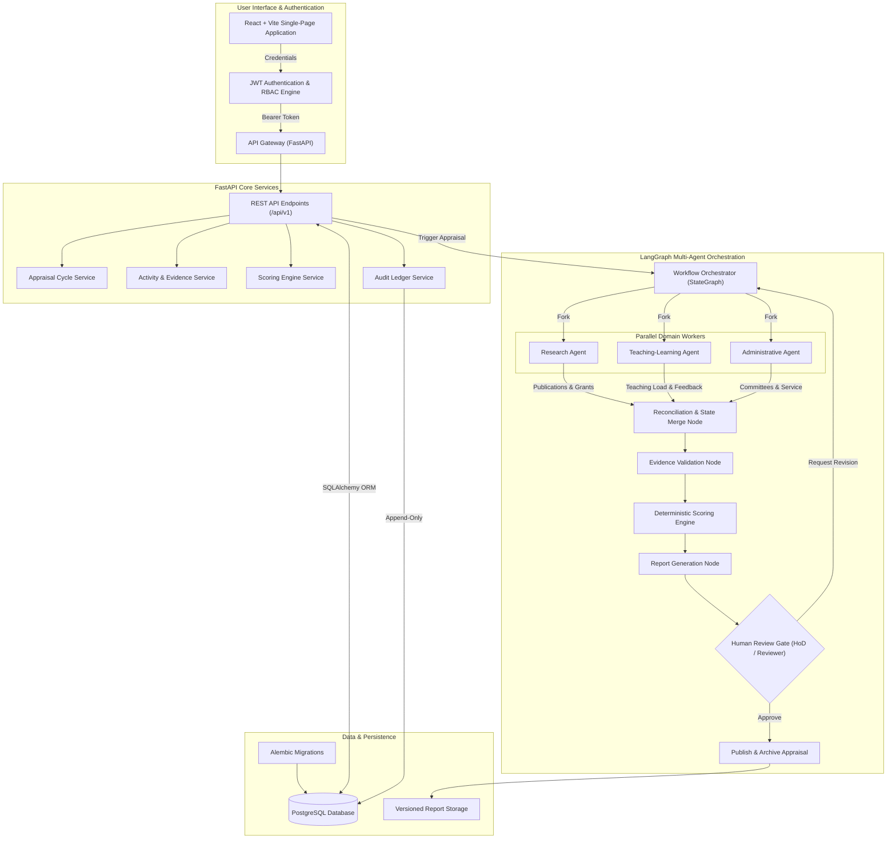

# Faculty Appraisal Management System

An enterprise-grade, governed multi-agent appraisal workflow system designed to automate the collection, validation, evaluation, and reporting of academic faculty performance across Research, Teaching-Learning, and Administrative domains.

[-blue.svg)](#team-details)
[](#team-details)
[](https://www.python.org/)
[](https://fastapi.tiangolo.com/)
[](https://react.dev/)
[](https://www.langchain.com/langgraph)

---

## Table of Contents

- [1. Team Details](#1-team-details)
- [2. Project Overview](#2-project-overview)
- [3. Problem Statement](#3-problem-statement)
- [4. Project Objectives](#4-project-objectives)
- [5. Proposed Approach & Architecture](#5-proposed-approach--architecture)
  - [5.1 Sequential Appraisal Lifecycle](#51-sequential-appraisal-lifecycle)
  - [5.2 System Architecture Diagram](#52-system-architecture-diagram)
  - [5.3 Phase 1 Implementation vs. Intended Full Workflow](#53-phase-1-implementation-vs-intended-full-workflow)
- [6. Technology Stack](#6-technology-stack)
- [7. Overview of the 12 Assignments](#7-overview-of-the-12-assignments)
- [8. Detailed Implementation & Scope (Phase 1)](#8-detailed-implementation--scope-phase-1)
  - [8.1 Core Modules Implemented](#81-core-modules-implemented)
  - [8.2 Out-of-Scope Features (Future Development)](#82-out-of-scope-features-future-development)
- [9. Results and Testing](#9-results-and-testing)
  - [9.1 Verified System Capabilities](#91-verified-system-capabilities)
  - [9.2 Automated Test Execution Analysis](#92-automated-test-execution-analysis)
  - [9.3 Scoring Engine Disclaimer](#93-scoring-engine-disclaimer)
- [10. Project Resources and Documentation Links](#10-project-resources-and-documentation-links)
- [11. Installation and Execution Instructions](#11-installation-and-execution-instructions)
  - [11.1 Prerequisites](#111-prerequisites)
  - [11.2 Step-by-Step Setup (Windows PowerShell)](#112-step-by-step-setup-windows-powershell)
  - [11.3 Local Demo Credentials](#113-local-demo-credentials)
- [12. Limitations and Future Enhancements](#12-limitations-and-future-enhancements)

---

## 1. Team Details

- **Team Number:** 04
- **Institution:** KLE Technological University
- **Course:** Agentic AI (26ECAC401)
- **Discipline:** Computer Science and Engineering – Artificial Intelligence
- **Division:** A
- **Project Title:** Faculty Appraisal Management System (Worklet Topic 8)

### Team Members

| Sl. No. | Name | USN | Division | Roll no |
|:---:|:---|:---:|:---:|
| 1 | Sneha Sanjeevkumar Baragi | 01FE23BCI054 | A | 125 |
| 2 | Bhagyashree Anand Mugalkhod | 01FE23BCI118 | A | 155 |
| 3 | B V Om | 01FE23BCI055 | A | 126 |
| 4 | Siddharth Gaikwad | 01FE23BCI051 | A | 110 |

---

## 2. Project Overview

The **Faculty Appraisal Management System** (Topic 8 of the Agentic AI Worklets project) is an autonomous, governed multi-agent solution designed to streamline the annual Performance Based Appraisal System (PBAS) for academic institutions. Faculty evaluations historically demand substantial administrative effort to assemble, verify, calculate, and audit faculty contributions across disparate institutional records.

This project introduces a **governed multi-agent workflow** that partitions appraisal collection and evaluation across three primary academic domains:
1. **Research & Scholarly Contributions:** Automated indexing and aggregation of peer-reviewed publications, journal impact metrics, citations, conference presentations, research grants, and patents.
2. **Teaching-Learning & Pedagogical Activities:** Aggregation of course instruction loads, verified student feedback scores, syllabus coverage, and institutional attendance compliance.
3. **Administrative & Institutional Responsibilities:** Tracking departmental administrative roles, statutory committee memberships, examination duties, student mentorship, and community outreach.

Rather than relying on unconstrained LLM decision-making, the system couples specialized agent execution with deterministic scoring algorithms, rigorous evidence validation, immutable audit trails, and mandatory human review gates before final appraisal publication.

---

## 3. Problem Statement

Traditional faculty appraisal workflows in higher educational institutions encounter systemic bottlenecks that hinder efficiency, accuracy, and fairness:

- **Fragmented Data Sources:** Faculty achievements and supporting evidence are scattered across institutional ERP databases, Learning Management Systems (LMS), personal spreadsheets, and external scholarly registries (Google Scholar, Scopus, ORCID).
- **Manual Verification Overhead:** Department heads, deans, and Internal Quality Assurance Cells (IQAC) spend weeks manually cross-checking physical and digital certificates against self-reported faculty claims.
- **Error-Prone Score Computation:** Academic Performance Indicator (API) formulas involve category-specific caps, weighted sub-components, and multi-tier institutional rules that invite human calculation errors and grading inconsistencies.
- **Incomplete or Inconsistent Evidence:** Submissions frequently lack mandatory metadata (e.g., ISSN, DOI, approval signatures, dates), triggering recursive, delayed clarification cycles.
- **Lack of Process Traceability & Transparency:** Traditional manual reviews offer limited auditability into who reviewed an activity, when points were altered, or what rationale governed an override.
- **Accountability Requirements:** Institutions require verifiable, tamper-evident audit logs to ensure compliance with university statutes, accreditation standards (NAAC, NBA, NIRF), and statutory guidelines.

---

## 4. Project Objectives

1. **Automate Appraisal Data Collection:** Ingest faculty performance data from structured sources, databases, and digital records without manual data re-entry.
2. **Specialized Multi-Agent Decomposition:** Isolate collection into domain-specific agents (Research Agent, Teaching-Learning Agent, and Administrative Agent) running concurrently under centralized orchestration.
3. **Strict Evidence Verification:** Cross-reference every reported achievement against mandatory evidence documents and verification rules before admitting claims to scoring.
4. **Deterministic & Transparent Scoring:** Implement an auditable, deterministic scoring engine applying institutional weights, category caps, and sub-tier bounds without non-deterministic LLM variance.
5. **Structured Artifact & Report Generation:** Generate comprehensive appraisal dossiers containing executive summaries, category-level breakdowns, line-item audits, and traceable run identifiers.
6. **Human-in-the-Loop Governance:** Enforce mandatory review and sign-off by designated authorities (Head of Department, Dean, IQAC) prior to appraisal finalization.
7. **Comprehensive Auditability & RBAC:** Enforce strict Role-Based Access Control (`faculty`, `hod`, `admin`) and maintain an append-only audit ledger recording every state change and review decision.
8. **Traceable & Reproducible Workflow:** Guarantee end-to-end reproducibility across appraisal cycles, versioned reports, and institutional overrides.

---

## 5. Proposed Approach & Architecture

### 5.1 Sequential Appraisal Lifecycle

The faculty appraisal lifecycle executes as a sequence of governed stages:

```
[Faculty Authentication & Cycle Selection]
                   │
                   ▼
       [Workflow Planning & Coordination]
                   │
   ┌───────────────┼───────────────┐
   ▼               ▼               ▼
[Research]    [Teaching]    [Administrative]
 [Agent]        [Agent]         [Agent]
   │               │               │
   └───────────────┼───────────────┘
                   │ (Parallel Execution)
                   ▼
     [Data Merging & Reconciliation]
                   │
                   ▼
          [Evidence Validation]
                   │
                   ▼
    [Deterministic Score Calculation]
                   │
                   ▼
      [Appraisal Report Generation]
                   │
                   ▼
      [Authorized Human Review Gate]  <── (HoD / Dean / IQAC)
                   │
            (Approved / Revision)
                   │
                   ▼
     [Final Publication & Archival]
```

1. **Faculty Authentication & Cycle Selection:** Faculty authenticate via secure JWT credentials and select an active appraisal cycle (e.g., `2025-2026`).
2. **Workflow Coordination & Planning:** The orchestrator initializes the appraisal state, validates active cycle parameters, and delegates domain queries.
3. **Parallel Multi-Agent Collection:** Independent worker agents gather data concurrently:
   - *Research Agent:* Gathers publication records, citations, grants, and external indexing data.
   - *Teaching-Learning Agent:* Collects course loads, attendance data, and student feedback metrics.
   - *Administrative Agent:* Compiles departmental roles, committee appointments, and institutional duties.
4. **Data Merging & Reconciliation:** Domain payloads are merged into a canonical appraisal state, resolving cross-domain conflicts and filtering duplicates.
5. **Evidence Validation:** Supporting evidence documents (appointment letters, journal links, grade sheets) are validated for presence, format, and authenticity.
6. **Deterministic Score Calculation:** The core scoring engine computes raw claimed points, enforces regulatory ceilings and category caps, and calculates weighted total scores.
7. **Appraisal Report Generation:** A versioned, structured appraisal dossier is generated, embedding complete calculation trails and metadata.
8. **Authorized Human Review Gate:** Department heads and authorized reviewers inspect the breakdown, review attached evidence, and submit approval, remarks, or institutional overrides.
9. **Controlled Approval & Publication:** Upon formal sign-off, the appraisal status transitions to finalized, freezing the record for institutional archival.

### 5.2 System Architecture Diagram



### 5.3 Phase 1 Implementation vs. Intended Full Workflow

To maintain absolute technical transparency, the current Phase 1 implementation is distinguished from the planned production architecture:

| Capability | Phase 1 Implementation (Current) | Intended Full Production Workflow |
|:---|:---|:---|
| **Human Review Gate** | **Compile-safe placeholder node** in LangGraph; executes synchronously to validate graph connectivity without stopping execution. | **Persisted LangGraph interrupt/checkpoint** backed by PostgreSQL/Redis; pauses execution, persists state, and awaits asynchronous reviewer input via UI. |
| **Scoring Computation** | **Deterministic rule-based engine** (`backend/app/scoring/engine.py`); pure mathematical verification without LLM cost or latency. | Deterministic engine combined with LLM-assisted qualitative analysis of teaching philosophies, course syllabi, and research abstracts. |
| **Evidence Management** | Schema models and metadata records in PostgreSQL (`Evidence` table). | Full object storage integration (MinIO/AWS S3) with secure multipart upload, virus scanning, and automated document text extraction (OCR). |
| **Agent Execution** | LangGraph StateGraph skeleton with synchronous parallel branches and controlled state aggregation. | Distributed asynchronous execution with live streaming events, real-time socket updates, and automated retry/healing. |
| **Frontend Integration** | Authenticated React shell with login view and placeholder Faculty and Reviewer dashboards. | Interactive multi-step appraisal wizard, live evidence preview, line-item scoring override UI, and PDF report export. |

---

## 6. Technology Stack

The system is engineered using a robust, modern open-source stack verified in the repository:

| Layer / Technology | Component | Role in the System |
|:---|:---|:---|
| **Language** | Python 3.11+ / 3.13 | Core programming language powering backend services, agents, scoring algorithms, and test suites. |
| **Web Framework** | FastAPI | Asynchronous REST API framework providing fast routing, OpenAPI/Swagger interactive documentation, and Pydantic validation. |
| **Database** | PostgreSQL | Enterprise-grade relational database storing users, cycles, activities, evidence metadata, appraisal scores, and audit logs. |
| **ORM** | SQLAlchemy 2.0 | Type-safe Object-Relational Mapping providing clean database abstractions, session handling, and transactional integrity. |
| **Migrations** | Alembic | Version-controlled database migration management ensuring seamless schema evolution and rollback capabilities. |
| **Orchestration** | LangGraph | State machine and multi-agent graph orchestration framework managing parallel worker nodes, state merges, and review routing. |
| **Frontend Framework** | React 18 + Vite | Fast, modern frontend library with Vite tooling providing a responsive single-page web interface. |
| **Styling** | Tailwind CSS | Utility-first CSS framework delivering clean, accessible administrative and faculty dashboard layouts. |
| **Authentication** | JWT & Passlib (Bcrypt) | Secure stateless token authentication, password hashing, and Role-Based Access Control (`faculty`, `hod`, `admin`). |
| **Containerization** | Docker Compose | Multi-container environment definition managing containerized PostgreSQL database and backend application execution. |
| **Testing** | Pytest | Comprehensive test framework supporting unit tests, integration tests, API client testing, and security verification. |

---

## 7. Overview of the 12 Assignments

The repository includes a comprehensive series of independent laboratory implementations demonstrating foundational and advanced agentic AI concepts:

| Assignment | Title | Status | Primary Focus & Concept Explored | Lab Directory |
|:---:|:---|:---:|:---|:---:|
| **Lab 01** | Agent vs. Chatbot | Completed | Comparative analysis of reactive conversational chatbots versus autonomous goal-directed agents with state and memory. | [Lab-01](./labs/Lab-01-Agent-vs-Chatbot/) |
| **Lab 02** | Tool-Using Agent | Completed | Deterministic tool calling, schema-based argument parsing, external calculation tools, and error-recovery routines. | [Lab-02](./labs/Lab-02-Tool-Using-Agent/) |
| **Lab 03** | Skill Creation | Completed | Modular skill abstraction, capability encapsulation, structured JSON schema input/output contracts, and academic synthesis. | [Lab-03](./labs/Lab-03-Skill-Creation/) |
| **Lab 04** | Memory & Retrieval | Completed | Short-term conversation buffers, long-term memory stores, keyword/semantic retrieval, and contextual recall for appraisal history. | [Lab-04](./labs/Lab-04-Memory-Retrieval/) |
| **Lab 05** | MCP-Style Connector | Completed | Model Context Protocol (MCP) mini integration layer exposing local files, SQLite databases, and mock REST APIs via standardized tools. | [Lab-05](./labs/Lab-05-MCP-Connector/) |
| **Lab 06** | OpenClaw Personal Runtime | Completed | Lightweight personal agent runtime with session management, tool sandboxing, policy enforcement, and execution audit logging. | [Lab-06](./labs/Lab-06-OpenClaw-Runtime/) |
| **Lab 07** | Agentic Node Graph | Completed | Graph-based multi-agent orchestration for faculty appraisal using parallel collectors, state merging, scoring, and human review gates. | [Lab-07](./labs/Lab-07-Agentic-Node-Graph/) |
| **Lab 08** | Parallel Swarm | Completed | Swarm architecture with parallel domain workers, source-specific consent isolation, institutional overrides, and versioned report preservation. | [Lab-08](./labs/Lab-08-Parallel-Swarm/) |
| **Lab 09** | Deep Research Agent | In Progress – Assigned to Team Members | Autonomous multi-source literature search, bibliographic citation cross-referencing, paper synthesis, and venue verification. | Assigned to team member (Pending push) |
| **Lab 10** | Cloud Operations Agent | In Progress – Assigned to Team Members | Cloud telemetry inspection, automated container health monitoring, log anomaly detection, and operational self-healing. | Assigned to team member (Pending push) |
| **Lab 11** | Agentic SDLC Factory | In Progress – Assigned to Team Members | Autonomous software engineering pipeline automating user story decomposition, test-driven code generation, and CI/CD validation. | Assigned to team member (Pending push) |
| **Lab 12** | Safety, Security & Governance | In Progress – Assigned to Team Members | Guardrail policy enforcement, prompt injection defense, sensitive PII redaction, role boundaries, and immutable audit ledgers. | Assigned to team member (Pending push) |

> **Team Collaboration Note on Labs 09–12:**
> Labs 9, 10, 11, and 12 are actively assigned to other team members who are developing their implementations independently. They will push their code, test suites, and documentation directly to this repository. The respective directory links will be added once their commits appear on the repository branch.

> **Note on Capstone Assignments (Labs 13 & 14):**
> Advanced curriculum modules **Lab 13 (Capstone Project Studio)** and **Lab 14 (Discipline-Specific Agents)** represent capstone-level syntheses and domain specializations designed to build upon the 12 core competencies above. They are maintained in curriculum planning without disrupting the foundational 12-assignment laboratory framework.

---

## 8. Detailed Implementation & Scope (Phase 1)

### 8.1 Core Modules Implemented

The Phase 1 infrastructure establishes a production-grade foundation for the integrated application:

- **Relational Data Architecture (`backend/app/models/`):**
  - `User`: Authentication identity, email, hashed credentials, and system roles (`faculty`, `hod`, `admin`).
  - `FacultyProfile`: Institutional metadata, department affiliation, designation, and employee code.
  - `AppraisalCycle`: Cycle definition (e.g., `2025-2026`), submission start/end dates, and lifecycle states (`OPEN`, `UNDER_REVIEW`, `FINALIZED`).
  - `Activity`: Granular faculty contributions categorized under `RESEARCH`, `TEACHING`, or `ADMINISTRATIVE`, tracking claimed vs. verified points.
  - `Evidence`: Document metadata referencing attached proof, file types, verification status, and validation notes.
  - `AuditLog`: Append-only institutional audit ledger recording user actions, IP addresses, entity mutations, and review overrides.
- **Database Migrations (`backend/alembic/`):** Version-controlled Alembic migrations ensuring clean, reproducible schema deployments and rollbacks across environments.
- **REST API Endpoints (`backend/app/api/`):**
  - `GET /health`: Operational readiness and application health probe.
  - `POST /api/v1/auth/login`: Secure OAuth2-compatible password login issuing signed JWT tokens.
  - `GET /api/v1/auth/me`: Authenticated user profile and role verification.
  - Additional endpoints for appraisal cycle inspection and activity management.
- **Deterministic Scoring Engine (`backend/app/scoring/engine.py`):**
  - Pure Python calculation engine implementing category formulas, regulatory ceilings, and weighted contributions.
  - Eliminates non-deterministic variance and latency by avoiding external LLM calls for arithmetic calculations.
  - Ensures 100% reproducible results given identical activity inputs.
- **LangGraph Multi-Agent Graph (`backend/app/agents/graph.py`):**
  - StateGraph defining parallel collector execution (`collect_research`, `collect_teaching`, `collect_admin`).
  - State aggregation and evidence reconciliation node.
  - Compile-safe placeholder human review gate demonstrating node graph traversal and state propagation.
- **Frontend Application Shell (`frontend/`):**
  - React 18 single-page application bundled with Vite.
  - Login view with JWT credential persistence.
  - Role-based view routing displaying dedicated shells for Faculty and Reviewer interfaces.

### 8.2 Out-of-Scope Features (Future Development)

The following capabilities are intentionally scheduled for subsequent phases and are **not** part of Phase 1:

- **Object Storage Integration:** MinIO/AWS S3 bucket integration for physical file storage and virus scanning.
- **End-to-End Evidence File Upload:** Direct multipart upload and automated OCR/PDF content extraction.
- **Live LLM Calls:** Real-time generation of qualitative performance summaries via commercial LLM APIs.
- **Persisted LangGraph Checkpointer:** Persistent state checkpointer (PostgreSQL/Redis) supporting long-lived interrupt and resume cycles for human review.
- **Automated Workflow Healing:** Self-correcting retry loops for transient external API failures.
- **Appraisal Publication & Distribution:** Automated generation and email distribution of signed institutional appraisal letters.
- **Web UI Rollback Interface:** Interactive frontend controls for executing audit rollbacks or contesting scores.

---

## 9. Results and Testing

### 9.1 Verified System Capabilities

The Phase 1 implementation has verified the following end-to-end capabilities:
- **Operational Health Probe:** `GET /health` confirms database connectivity and service availability (`{"status": "healthy"}`).
- **Authentication & Authorization:** Secure JWT token issuance, password validation using bcrypt hashing, and strict role enforcement across protected endpoints.
- **Database Integrity:** Successful execution of Alembic migrations creating relational constraints, foreign keys, and indexes.
- **Scoring Engine Precision:** Complete test verification of raw point calculations, category caps, and weighted totals across all three domains.
- **Graph Traversal:** LangGraph StateGraph compiles cleanly, branches into parallel collectors, merges payloads, and executes through review gates.
- **Evidence Upload & Storage Security:** Verified bounded chunk reading, file type validation, and storage cleanup with MinIO container active.
- **Frontend Interaction:** React + Vite application builds cleanly and supports authenticated session storage.

### 9.2 Automated Test Execution Analysis

The backend test suite in `backend/tests/` was executed using Pytest with the local Docker dependencies (`db` and `minio`) active and healthy:

- **Total Test Cases Collected:** **278 test items** across unit, integration, scoring, and security modules.
- **Execution Summary:**
  - **Passed Tests (276 items):** 100% of executable tests passed, verifying:
    - Core domain models, activity lifecycles, and relational constraints.
    - Authentication, JWT token issuance, and RBAC boundary enforcement.
    - Deterministic scoring engine arithmetic, category bounds, and ceiling caps.
    - LangGraph StateGraph compile-safe flow and state propagation.
    - Evidence upload security, bounded chunk reading, MIME validation, and storage cleanup (verified with MinIO running on port 9000).
    - Immutable audit ledger entries and administrative overrides.
    - Student feedback processing and course attendance synchronization.
  - **Failed Tests:** **0 failed** (all upload and storage tests pass with MinIO online).
  - **Skipped Tests (2 items):** In `test_checkpoint_postgres_restart.py`, designed for live container restart integration testing.
  - **Process Exit Code:** **Exit code 0** (clean, successful execution).
  - **Test Duration:** ~92 seconds.

> [!TIP]
> Both the PostgreSQL database and MinIO storage services must be running (`docker compose up -d db minio`) to execute the full test suite with exit code 0. If MinIO is offline, the 7 evidence upload tests in `test_upload_security.py` will fail with connection refused.

### 9.3 Scoring Engine Disclaimer

> [!WARNING]
> **Scoring Disclaimer:** The Academic Performance Indicator (API) formulas, category weightages, and ceiling caps implemented in `backend/app/scoring/engine.py` are **DEMO and TEST values** designed for academic evaluation and demonstration. They do **not** represent official University Grants Commission (UGC) regulations, National Institutional Ranking Framework (NIRF) criteria, or binding institutional appraisal standards.

---

## 10. Project Resources and Documentation Links

- **Assignment Implementations:** [Independent Lab Assignments (`labs/`)](./labs/)
- **Architecture & System Guide:** [Root Project Configuration](./README.md)
- **Project Documentation:** [Project Documentation – link to be added] *(Placeholder: Add path to formal project design document)*
- **Final Evaluation Report:** [Final Report – link to be added] *(Placeholder: Add path to final project report / presentation slides)*

---

## 11. Installation and Execution Instructions

Follow these step-by-step instructions to configure, run, and test the system locally using Windows PowerShell.

### 11.1 Prerequisites

- **Python:** Version 3.11 or 3.13 installed and available on your system `PATH`.
- **Node.js:** Version 18+ and `npm` installed.
- **Docker & Docker Compose:** Docker Desktop installed and running.
- **Git:** Git client installed.

### 11.2 Step-by-Step Setup (Windows PowerShell)

Each step below is clearly documented with its working directory so that commands can be executed sequentially or independently.

#### Step 1: Environment Configuration

From the repository root (`E:\Faculty-Appraisal-Agent`):

```powershell
Set-Location E:\Faculty-Appraisal-Agent
Copy-Item .env.example .env
```

#### Step 2: Start PostgreSQL & MinIO Containers

From the repository root (`E:\Faculty-Appraisal-Agent`):

```powershell
Set-Location E:\Faculty-Appraisal-Agent
docker compose up -d db minio
```
*(Starts the PostgreSQL database on port 15432 and the MinIO object storage service on ports 9000/9001 for evidence testing).*

#### Step 3: Backend Virtual Environment & Dependencies

Navigate to `backend`, create the Python virtual environment, activate it, and install dependencies:

```powershell
Set-Location E:\Faculty-Appraisal-Agent\backend
python -m venv .venv
.\.venv\Scripts\Activate.ps1
pip install -r requirements.txt
```

#### Step 4: Run Database Migrations

Apply Alembic migrations to create the database schema.

- **If already in `backend` with `.venv` activated:**
  ```powershell
  alembic upgrade head
  ```
- **If running independently from repository root:**
  ```powershell
  Set-Location E:\Faculty-Appraisal-Agent\backend
  .\.venv\Scripts\Activate.ps1
  alembic upgrade head
  ```

#### Step 5: Seed Database with Initial Data

Populate the database with default appraisal cycles, activity categories, and test user accounts.

- **If already in `backend` with `.venv` activated:**
  ```powershell
  python -m app.seed
  ```
- **If running independently from repository root:**
  ```powershell
  Set-Location E:\Faculty-Appraisal-Agent\backend
  .\.venv\Scripts\Activate.ps1
  python -m app.seed
  ```

#### Step 6: Start the FastAPI Backend Server

Launch the asynchronous FastAPI development server.

- **If already in `backend` with `.venv` activated:**
  ```powershell
  uvicorn app.main:app --reload --host 0.0.0.0 --port 8000
  ```
- **If running independently from repository root:**
  ```powershell
  Set-Location E:\Faculty-Appraisal-Agent\backend
  .\.venv\Scripts\Activate.ps1
  uvicorn app.main:app --reload --host 0.0.0.0 --port 8000
  ```

- **API Base URL:** `http://localhost:8000`
- **Health Check Endpoint:** `http://localhost:8000/health`
- **Interactive Swagger Docs:** `http://localhost:8000/docs`

#### Step 7: Start the React Frontend Application

Open a **separate** Windows PowerShell terminal and launch the Vite development server:

```powershell
Set-Location E:\Faculty-Appraisal-Agent\frontend
npm install
npm run dev
```

- **Frontend Application URL:** `http://localhost:5173`

#### Step 8: Run Backend Test Suite

Execute the automated test suite using Pytest.

- **If already in `backend` with `.venv` activated:**
  ```powershell
  $env:PYTHONPATH = "E:\Faculty-Appraisal-Agent"
  pytest -q
  ```
- **If running independently from repository root:**
  ```powershell
  Set-Location E:\Faculty-Appraisal-Agent\backend
  .\.venv\Scripts\Activate.ps1
  $env:PYTHONPATH = "E:\Faculty-Appraisal-Agent"
  pytest -q
  ```

#### Optional: Full Stack Execution via Docker Compose

To run the complete backend API and PostgreSQL database together in Docker (automatically applying migrations and seeding):

```powershell
Set-Location E:\Faculty-Appraisal-Agent
docker compose up --build
```

*(Note: The React frontend remains run via `npm run dev` in the `frontend` directory.)*

### 11.3 Local Demo Credentials

After running the database seed script (`python -m app.seed`), the following local demo accounts are available for testing:

| Role | Email | Password | Access Scope |
|:---|:---|:---|:---|
| **Faculty** | `faculty@demo.local` | `faculty-demo` | Submit appraisal claims, view personal scores, and inspect feedback. |
| **HoD (Reviewer)** | `hod@demo.local` | `hod-demo` | Review departmental submissions, inspect evidence, and submit approvals. |
| **Admin** | `admin@demo.local` | `admin-demo` | System-wide access, cycle management, and audit log inspection. |

> [!NOTE]
> These credentials are seeded strictly for local development, academic review, and functional testing. Never use these credentials in a production environment.

---

## 12. Limitations and Future Enhancements

While Phase 1 delivers a robust architectural backbone, several enhancements are scheduled for upcoming development phases:

1. **Integrated Object Storage (MinIO / S3):**
   - Connect authenticated MinIO storage for supporting documents (PDFs, certificates, appointment letters).
   - Implement presigned URLs, MIME-type verification, and automated virus scanning.
2. **Automated Evidence Ingestion & Parsing:**
   - Integrate OCR and document parsing models to automatically extract publication titles, authors, DOIs, and dates from uploaded certificates.
3. **External Research Registry Integration:**
   - Implement live connectors for Google Scholar, Scopus, Web of Science, and ORCID to automatically pull citation counts and h-index metrics.
4. **Persistent LangGraph Human-in-the-Loop Checkpointing:**
   - Transition the current compile-safe human gate into a persistent checkpointer using PostgreSQL/Redis.
   - Support asynchronous pauses where an appraisal halts, notifies the HoD via email/dashboard, and safely resumes upon human approval.
5. **Interactive Reviewer & Faculty Dashboard:**
   - Build out comprehensive React interfaces enabling faculty to upload files, track real-time appraisal progress, and view line-item score explanations.
   - Provide department heads with side-by-side evidence inspection, inline annotation tools, and formal objection resolution workflows.
6. **Multi-Tier Review Hierarchy:**
   - Expand the single-stage human gate into a multi-tier governance pipeline: **Faculty Submission → HoD Evaluation → Dean Endorsement → IQAC Verification**.
7. **Automated Self-Healing & Audit Rollbacks:**
   - Develop autonomous recovery agents capable of detecting transient failure states and rolling back corrupted appraisal transactions to the last verified checkpoint.

---

*Developed by Team 04 (KLE Technological University) for the Agentic AI (26ECAC401) Laboratory Course.*
