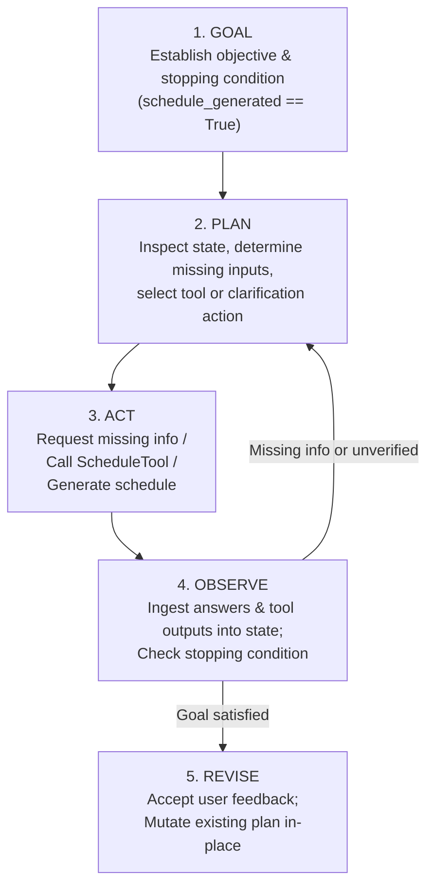

# Lab 1: Agent vs Chatbot — Study Planner

**Course:** Agentic AI (26ECAC401)
**Skill:** Agents & Agentic Reasoning
**Scenario:** Weekly Study Planner
**Objective:** Build and evaluate the foundational Agent Loop (**GOAL → PLAN → ACT → OBSERVE → REVISE**).

---

## 1. Lab Title & Objective

- **Title:** Lab 1: Conventional Chatbot vs. Autonomous Planning Agent
- **Objective:** Design, implement, and compare a conventional prompt-response chatbot with a stateful, tool-using autonomous planning agent. Specifically, observe how an agent:
  1. Identifies missing requirements and asks targeted clarification questions.
  2. Autonomously queries an external tool (`ScheduleTool`) to detect calendar conflicts.
  3. Synthesizes a structured 7-day study plan with explicit assumptions.
  4. Accepts user feedback and **mutates the existing plan in-place** without re-planning from scratch.
  5. Records an immutable, step-by-step **iteration audit log** tracking its internal reasoning loop.

---

## 2. Problem Scenario

A student submits an incomplete request for a one-week study schedule:
> *"Can you make me a study plan for Data Structures, Operating Systems, and AI Agents? I want to study 2 hours per day."*

The request lacks essential parameters:
- Which days of the week is the student unavailable (e.g., personal commitments, rest days)?
- Does the student have pre-existing institutional commitments (e.g., department seminars, laboratory sessions)?

### Expected System Behaviors
- **Conventional Chatbot:** Naively generates an arbitrary 7-day schedule, assumes 7 active study days, ignores institutional commitments, and re-generates fresh text from scratch if feedback is provided.
- **Autonomous Planning Agent:** Recognizes incomplete state, queries only for missing days, fetches the student's institutional timetable using `read_existing_schedule()` (returning $\ge 2$ busy days: Wednesday and Friday), detects Friday as an uncovered conflict and proactively excludes it, marks Sunday as off, states all assumptions, explicitly verifies that every busy day is excluded before finalization, and mutates Tuesday's slot to the evening upon receiving user feedback while preserving the rest of the schedule.

---

## 3. Theory: Agent vs. Chatbot

| Dimension | Conventional Chatbot | Autonomous Planning Agent |
| :--- | :--- | :--- |
| **Execution Pattern** | Single-turn, reactive prompt $\to$ response. | Multi-turn, stateful autonomous loop. |
| **State Tracking** | Stateless; conversation history is plain text tokens. | Structured internal state schema with typed attributes. |
| **Goal Orientation** | Passive; halts when text tokens finish streaming. | Active; works towards a declared goal stopping condition. |
| **Missing Information** | Guesses, hallucinates, or fills static defaults. | Analyzes state, identifies missing keys, asks targeted questions. |
| **Tool Integration** | None; operates as a closed-box text predictor. | Active tool execution (`ScheduleTool`) with error handling. |
| **Plan Revision** | Discards prior output and regenerates from scratch. | **In-place mutation** of the existing schedule object. |
| **Auditability** | None; internal reasoning is opaque. | Step-by-step iteration log (`Plan`, `Act`, `Observe`, `Revise`). |

---

## 4. The Goal–Plan–Act–Observe–Revise Loop

The core architecture follows the 5-phase agentic loop:



1. **GOAL:** Declare operational objective and verifiable stopping condition (`schedule_generated == True`).
2. **PLAN:** Examine internal state. Determine what is known and what is missing (`unavailable_days`).
3. **ACT:** Execute actions: request clarification for missing items, call `schedule_tool.read_existing_schedule()`, and construct the 7-day plan.
4. **OBSERVE:** Record tool outputs and clarification answers into structured state. Verify constraint satisfaction.
5. **REVISE:** Receive student feedback (e.g., *"Move Tuesday's session to the evening"*) and mutate the specific slot directly without modifying unaffected days.

---

## 5. Architecture & Component Responsibilities

```
labs/Lab-01-Agent-vs-Chatbot/
│
├── chatbot/
│   └── chatbot.py            # Conventional single-turn, tool-less chatbot
│
├── agent/
│   ├── planner_agent.py      # Stateful StudyPlannerAgent with autonomous loop
│   └── schedule_tool.py      # Institutional timetable tool with error simulation
│
├── examples/
│   └── sample_inputs.json    # Test cases & demonstration payloads
│
├── tests/
│   ├── test_chatbot.py       # Unit tests verifying conventional chatbot limits
│   └── test_planner_agent.py # Comprehensive unit tests for the agent loop
│
├── main.py                   # CLI demonstration runner (Demo, Interactive, Assignments)
├── requirements.txt          # Dependency specification (Standard library only)
└── README.md                 # Lab documentation & architectural guide
```

### Component Breakdown
- [`chatbot/chatbot.py`](file:///e:/Faculty-Appraisal-Agent/labs/Lab-01-Agent-vs-Chatbot/chatbot/chatbot.py): Generates static responses without tools or state retention.
- [`agent/schedule_tool.py`](file:///e:/Faculty-Appraisal-Agent/labs/Lab-01-Agent-vs-Chatbot/agent/schedule_tool.py): Mock calendar service exposing `read_existing_schedule()` and throwing `ScheduleToolError` upon simulated network or API failure.
- [`agent/planner_agent.py`](file:///e:/Faculty-Appraisal-Agent/labs/Lab-01-Agent-vs-Chatbot/agent/planner_agent.py): Houses `AgentState`, `DaySchedule`, and `StudyPlannerAgent` implementing the loop, constraint validation, round-robin subject allocation, in-place revision, and audit logging.
- [`main.py`](file:///e:/Faculty-Appraisal-Agent/labs/Lab-01-Agent-vs-Chatbot/main.py): Structured CLI displaying comparison, initial schedule, user feedback, mutated schedule, and iteration logs.

---

## 6. Technology Stack & Justification

- **Language:** Python 3.10+ (Standard Library)
- **Zero Third-Party Dependencies:** Implemented purely with Python built-ins (`dataclasses`, `json`, `argparse`, `unittest`, `re`, `typing`).
- **Offline & Deterministic:** Uses deterministic rule-based logic in place of external LLM APIs so the agent loop mechanics, state transitions, and revision logic can be inspected, tested, and graded completely offline without API rate limits or costs.

---

## 7. Setup & Execution Instructions

### Setup
Ensure Python 3.10+ is installed. No pip installations are necessary.

```bash
# Navigate to the Lab 1 directory
cd labs/Lab-01-Agent-vs-Chatbot
```

### Running the Demonstrations

```bash
# 1. Run the standard deterministic demonstration
python main.py

# 2. Run Assignment 1 (Two Rounds of Feedback)
python main.py --assignment1

# 3. Run Assignment 2 (Conflict Detection)
python main.py --assignment2

# 4. Run Interactive Mode (Input your own subjects & hours)
python main.py --interactive
```

---

## 8. Expected Sample Output

```
==============================================================================
               LAB 1: AGENT VS CHATBOT (STUDY PLANNER SCENARIO)
              Course: Agentic AI (26ECAC401) · Demonstration Mode
==============================================================================

[1] CONVENTIONAL CHATBOT RESPONSE (SINGLE-TURN, NO TOOLS, STATELESS)
------------------------------------------------------------------------------
Student Prompt:
  "Hi! Can you create a weekly study plan for Data Structures, Operating Systems, and AI Agents? I want to study 2 hours per day."

[ConventionalStudyBot Response]
Hello! Here is a general study plan for your request:
• Monday: 2 hours of Data Structures
• Tuesday: 2 hours of Operating Systems
• Wednesday: 2 hours of AI Agents
• Thursday: 2 hours of Data Structures
• Friday: 2 hours of Operating Systems
• Saturday: 2 hours of AI Agents
• Sunday: 2 hours of General Review

Assumptions made by chatbot:
- Assumed 2 hours per day across all 7 days.
- Assumed you are available on Wednesday (did not check university timetable).
- Assumed you are available on Sunday (did not clarify preferred rest days).
- No tools were invoked; no persistent state was stored.

...

[5] INITIAL WEEKLY STUDY PLAN (ACT & OBSERVE)
------------------------------------------------------------------------------
Day         | Status         | Subject              | Hours  | Time Slot
------------------------------------------------------------------------------------
Monday      | STUDY          | Data Structures      | 2.0    | Morning (09:00 - 11:00)
Tuesday     | STUDY          | Operating Systems    | 2.0    | Morning (09:00 - 11:00)
Wednesday   | BUSY_CONFLICT  | —                    | 0.0    | Institutional Schedule
Thursday    | STUDY          | AI Agents            | 2.0    | Morning (09:00 - 11:00)
Friday      | BUSY_CONFLICT  | —                    | 0.0    | Institutional Schedule
Saturday    | STUDY          | Data Structures      | 2.0    | Morning (09:00 - 11:00)
Sunday      | UNAVAILABLE    | —                    | 0.0    | Off

...

[7] REVISED WEEKLY STUDY PLAN (REVISE - IN-PLACE MUTATION)
------------------------------------------------------------------------------
Agent mutates existing schedule object (does not re-plan from scratch)...
Day         | Status         | Subject              | Hours  | Time Slot
------------------------------------------------------------------------------------
Monday      | STUDY          | Data Structures      | 2.0    | Morning (09:00 - 11:00)
Tuesday     | STUDY          | Operating Systems    | 2.0    | Evening (18:00 - 20:00)
Wednesday   | BUSY_CONFLICT  | —                    | 0.0    | Institutional Schedule
Thursday    | STUDY          | AI Agents            | 2.0    | Morning (09:00 - 11:00)
Friday      | BUSY_CONFLICT  | —                    | 0.0    | Institutional Schedule
Saturday    | STUDY          | Data Structures      | 2.0    | Morning (09:00 - 11:00)
Sunday      | UNAVAILABLE    | —                    | 0.0    | Off

Verification of In-Place Mutation:
  • Tuesday Slot:   Evening (18:00 - 20:00) (Updated to Evening)
  • Monday Slot:    Morning (09:00 - 11:00) (Preserved)
  • Wednesday Slot: Institutional Schedule (Preserved Busy)
  • Thursday Slot:  Morning (09:00 - 11:00) (Preserved)
  • Friday Slot:    Institutional Schedule (Preserved Busy)
  • Saturday Slot:  Morning (09:00 - 11:00) (Preserved)
  • Sunday Slot:    Off (Preserved Rest)
```

---

## 9. Running Automated Tests

Run the full unit test suite using Python's standard `unittest` test runner:

```bash
# From within labs/Lab-01-Agent-vs-Chatbot/
python -m unittest discover -s tests -v
```

Expected result:
```
test_chatbot_does_not_call_tools ... ok
test_chatbot_generates_response ... ok
test_chatbot_no_state_preservation ... ok
test_chatbot_unverified_assumptions ... ok
test_agent_asks_only_for_missing_information ... ok
test_agent_calls_schedule_tool ... ok
test_agent_completes_goal_and_stopping_condition ... ok
test_agent_does_not_reask_known_information ... ok
test_assignment_1_two_rounds_of_feedback ... ok
test_assignment_2_schedule_conflict_detection ... ok
test_assignment_2_uncovered_conflict_detection_and_exclusion ... ok
test_detect_impossible_requirements ... ok
test_existing_busy_day_conflict_avoided ... ok
test_feedback_mutates_existing_plan_in_place ... ok
test_iteration_logs_populated_correctly ... ok
test_tool_failure_handled_explicitly ... ok
test_unavailable_days_excluded ... ok
test_verify_all_busy_days_excluded_raises_on_violation ... ok

----------------------------------------------------------------------
Ran 18 tests in 0.040s

OK
```

---

## 10. Official Lab Guide Assignments

### Assignment 1: Two Rounds of Feedback
- **Goal:** Verify that the agent can sustain multiple sequential revisions without discarding previous updates or re-planning from scratch.
- **Scenario:**
  - Round 1: Student requests: *"Move Tuesday's session to the evening."*
  - Round 2: Student requests: *"Swap Thursday and Saturday subjects so AI Agents is on Saturday."*
- **Outcome:** Tuesday retains its Evening slot, while Thursday and Saturday subjects are safely swapped between the active study slots.
- **Command:** `python main.py --assignment1`

### Assignment 2: Detect a Scheduling Conflict (Lab Guide Pages 8–9)
- **Goal:** Verify that `read_existing_schedule()` returns at least two busy days and that the agent explicitly identifies uncovered conflicts, reports them before finalizing the plan, and never silently schedules a busy day.
- **Specific Scenario:**
  - Student marks **Sunday** as unavailable.
  - The external institutional schedule tool returns **Wednesday and Friday** as busy ($\ge 2$ busy days).
  - **Friday is not initially marked unavailable** by the student.
  - The agent detects Friday as an **uncovered conflict**, records it in `state.uncovered_conflicts`, reports it in assumptions and iteration logs, and proactively excludes it from study sessions.
  - The agent executes an explicit pre-finalization check (`verify_all_busy_days_excluded`) ensuring Wednesday and Friday are strictly set to `BUSY_CONFLICT` with `0.0` study hours.
  - Friday is **never silently scheduled**.
- **Edge Case Coverage:** Also intercepts cases where all 7 days are blocked (e.g., 5 personal rest days + 2 institutional busy days) and halts safely with a descriptive `ValueError`.
- **Command:** `python main.py --assignment2`

---

## 11. Faculty Appraisal Management System Mapping

This Study Planner demonstrates the foundational planning and tool-orchestration pattern utilized by our larger capstone project: **The Faculty Appraisal Management System**.

| Study Planner Concept (Lab 1) | Faculty Appraisal System Equivalent |
| :--- | :--- |
| **Initial Request** | Faculty member initiates an annual appraisal run for an academic cycle. |
| **State Inspection (PLAN)** | Coordinator agent checks whether faculty profile, cycle dates, publications, and evidence files are present. |
| **Clarification (ACT)** | System prompts faculty for missing information (e.g., missing evidence documents or Scholar ID) instead of failing blindly. |
| **Tool Calling (ACT)** | Coordinator invokes specialized tools: Google Scholar API, institutional timetable/attendance database, and OCR evidence extractors. |
| **Observation (OBSERVE)** | Results (verified citations, attended lecture hours, validated PDFs) are stored in structured state. |
| **Plan Generation (ACT)** | Execution plan constructed: dispatching scoring engine and specialist reviewer agents. |
| **In-Place Revision (REVISE)**| When a reviewer requests changes or an appeal is submitted, the coordinator mutates specific appraisal line items without wiping the entire dossier. |

> **Note:** Lab 1 is an isolated pedagogical module designed to demonstrate the agent loop mechanics. It does not import or alter the integrated application's backend scoring engine, database tables, or frontend components.

---

## 12. Limitations & Future Enhancements

1. **Rule-Based Parsing:** Feedback parsing in Lab 1 uses deterministic regex and keyword heuristics. In future labs (Lab 2 & Lab 3), this is augmented with LLM tool-calling and function schemas.
2. **Calendar Conflict Resolution:** Currently, when an institutional conflict is detected (Wednesday seminar), the agent marks the day as blocked. Future iterations could offer automated reschedule suggestions (e.g., splitting a 2-hour session across two evenings).
3. **Multi-Week Horizon:** Currently scoped to a single 7-day window. Extending to multi-week study horizons with milestone tracking is straightforward using the same stateful loop.
