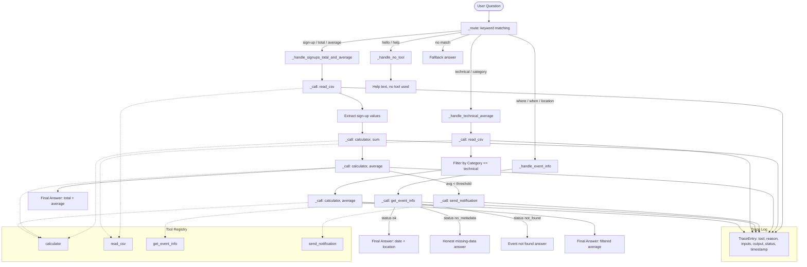

# Lab 2 – Tool-Using Agent: Campus Data Assistant

**Course:** Agentic AI (26ECAC401)  
**Lab Number:** 2  
**Skill:** Agents  
**Scenario:** Campus Data Assistant  
**Objective:** Function Calling and Tool Integration

---

## Table of Contents

1. [Lab Title and Objective](#1-lab-title-and-objective)
2. [Problem Statement](#2-problem-statement)
3. [Theory – Tool-Using Agents](#3-theory--tool-using-agents)
4. [Function Calling Explained](#4-function-calling-explained)
5. [Tool Descriptions and Contracts](#5-tool-descriptions-and-contracts)
6. [Architecture Diagram](#6-architecture-diagram)
7. [Tool Registry](#7-tool-registry)
8. [Tool Selection Logic](#8-tool-selection-logic)
9. [Tool Chaining](#9-tool-chaining)
10. [Folder Structure](#10-folder-structure)
11. [Technology Stack](#11-technology-stack)
12. [Installation and Setup](#12-installation-and-setup)
13. [Running the Demo](#13-running-the-demo)
14. [Expected Sample Output](#14-expected-sample-output)
15. [Reference Questions Explained](#15-reference-questions-explained)
16. [Running the Tests](#16-running-the-tests)
17. [Faculty Appraisal System Mapping](#17-faculty-appraisal-system-mapping)
18. [Official Assignments](#18-official-assignments)
19. [Limitations and Future Enhancements](#19-limitations-and-future-enhancements)

---

## 1. Lab Title and Objective

**Lab 2: Tool-Using Agent**

An agent that answers campus-related questions by **calling the right tool at the right time** — and nothing more.

| Item | Detail |
|------|--------|
| Scenario | Campus Data Assistant |
| Core skill | Function calling (structured tool invocation) |
| Tools | Calculator · CSV reader · Mock events API · Notification drafter |
| LLM required? | **No** — deterministic rule-based routing |
| External API? | **No** — offline mock only |

---

## 2. Problem Statement

The campus office needs answers to questions like:

- *"How many students signed up across all events in the dataset?"*
- *"Where and when is the Hackathon Kickoff?"*
- *"Where is the Capstone Expo being held?"*

A naive approach lets the agent generate answers directly from its own "knowledge." This is unreliable because:
- Sign-up numbers change and must be read from a live data source (CSV).
- Event dates and locations must come from an authoritative system (the events API).
- Computing totals and averages inside a prompt is error-prone and untraceable.

**The solution** is a *tool-using agent* that only uses tools when needed, records every tool call in a structured trace, and constructs its final answer entirely from verified tool results.

---

## 3. Theory – Tool-Using Agents

### What is a Tool-Using Agent?

A tool-using agent is an AI system that can invoke external functions — called **tools** — to retrieve data, perform computations, or trigger actions that it cannot reliably perform from its training alone.

```
  User question
      │
      ▼
  Agent (reasoning)
      │
      ├─── Does this need a tool?  ──No──▶ Answer directly
      │
      Yes
      │
      ▼
  Select the right tool
      │
      ▼
  Build structured input
      │
      ▼
  Call the tool
      │
      ▼
  Use the tool's output to answer
```

### Why Not Just Answer Directly?

| Risk | Without tools | With tools |
|------|--------------|------------|
| Accuracy | Hallucinated numbers | Real data |
| Traceability | Zero | Full trace |
| Auditability | None | Every call logged |
| Updatability | Requires retraining | Update the tool |

### Key Principles

1. **Tool calls only when needed** — do not invoke a tool for a question that can be answered without one.
2. **Structured input/output** — all arguments are typed dicts, not free text.
3. **Honest failure** — if a tool returns an error or missing data, the agent surfaces that honestly rather than fabricating an answer.
4. **Traceability** — every tool call is logged with its reason, input, output, and status.

---

## 4. Function Calling Explained

**Function calling** (also called *tool use* or *tool calling*) is the mechanism by which an agent maps a user's intent to a specific function with structured arguments.

### Example

User asks: *"How many students signed up?"*

1. Agent identifies that sign-up data lives in the CSV → selects `read_csv`.
2. Agent calls `read_csv()` → receives structured rows.
3. Agent extracts numeric values → builds `[12, 9, 15, 7, 20, 11]`.
4. Agent calls `calculator(operation="sum", values=[12, 9, 15, 7, 20, 11])` → `{"result": 74}`.
5. Agent calls `calculator(operation="average", values=[12, 9, 15, 7, 20, 11])` → `{"result": 12.33}`.
6. Agent constructs final answer from tool results: *"Total: 74, Average: 12.33"*.

The agent **never computes 74 + 12.33 on its own**. These values come exclusively from tool results.

---

## 5. Tool Descriptions and Contracts

### Tool 1 – Calculator (`tools/calculator.py`)

**Purpose:** Perform arithmetic on a list of numeric values.

| Field | Detail |
|-------|--------|
| Function | `calculator(operation, values)` |
| Operations | `"sum"`, `"average"` |
| Input | `{"operation": str, "values": list[int \| float]}` |
| Success output | `{"result": int \| float}` |
| Error output | `{"error": str}` |

**Example calls:**

```python
calculator(operation="sum", values=[12, 9, 15])
# → {"result": 36}

calculator(operation="average", values=[12, 9, 15])
# → {"result": 12.0}

calculator(operation="sum", values=[])
# → {"error": "Cannot perform operation on an empty list..."}
```

**Validation rules:**
- Operation must be `"sum"` or `"average"` (case-insensitive).
- `values` must be a non-empty list of `int` or `float` (not `bool`).
- Returns a structured error — never raises an exception to the caller.

---

### Tool 2 – CSV Reader (`tools/csv_reader.py`)

**Purpose:** Read the event sign-up CSV file and return structured rows.

| Field | Detail |
|-------|--------|
| Function | `read_csv(csv_path=None)` |
| Input | `{"csv_path": str \| None}` (optional override) |
| Success output | `{"rows": [...], "row_count": int, "columns": [...]}` |
| Error output | `{"error": str}` |

**Row structure:**

```python
{
    "Event":    "AI Club Talk",   # str
    "Signups":  12,               # int (never str)
    "Category": "technical"       # str (if column present)
}
```

**Validation rules:**
- File must exist and be non-empty.
- Columns `Event` and `Signups` are required.
- `Signups` values are validated as integers.
- Header-only files (no data rows) return an error.

**Important:** The CSV reader returns raw counts only. It **never** computes totals or averages — that is the calculator's job.

---

### Tool 3 – Mock Events API (`tools/events_api.py`)

**Purpose:** Retrieve event date and location from a deterministic local mock.

| Field | Detail |
|-------|--------|
| Function | `get_event_info(event_name)` |
| Input | `{"event_name": str}` |
| Success output | `{"status": "ok", "event_name": str, "date": str, "location": str}` |
| No-metadata | `{"status": "no_metadata", "event_name": str, "message": str}` |
| Not found | `{"status": "not_found", "error": str}` |

**Mock data:**

| Event | Status | Date | Location |
|-------|--------|------|----------|
| AI Club Talk | ✅ ok | 2026-07-02 | CS Block Auditorium |
| Hackathon Kickoff | ✅ ok | 2026-07-05 | Innovation Lab |
| Robotics Demo | ✅ ok | 2026-07-10 | Engineering Workshop |
| GenAI Workshop | ✅ ok | 2026-07-14 | Seminar Hall B |
| Capstone Expo | ⚠️ no_metadata | — | — |
| Career Panel | ✅ ok | 2026-07-20 | Main Auditorium |

**Design rules:**
- This is a **deterministic local mock** — no network call is made.
- The API never invents dates or locations.
- Three distinct status codes distinguish full data, partial data, and unknown events.

---

### Tool 4 – Notification Drafter (`tools/notifier.py`) — Assignment 1

**Purpose:** Draft a low-turnout alert message. Nothing is ever sent.

| Field | Detail |
|-------|--------|
| Function | `send_notification(message, threshold, actual_average)` |
| Input | `{"message": str, "threshold": float, "actual_average": float}` |
| Success output | `{"status": "drafted", "message": str, "drafted": True, ...}` |
| Error output | `{"error": str}` |

The output always contains `[DRAFT – NOT SENT]` as a prefix so it is impossible to mistake for a real notification.

---

## 6. Architecture Diagram



---

## 7. Tool Registry

The agent keeps a **central tool registry** (`_TOOL_REGISTRY` in `campus_assistant.py`). Each entry stores:

| Field | Description |
|-------|-------------|
| `name` | Tool identifier used in `_call()` |
| `description` | Human-readable explanation of when to use the tool |
| `input_schema` | JSON-schema-style dict describing valid inputs |
| `func` | The actual callable Python function |

**Why a registry?**

- **Validation**: The agent can reject calls to unknown tools rather than raising uncaught exceptions.
- **Introspection**: Instructor can inspect `agent.get_tool_registry()` to see all available tools.
- **Extensibility**: Adding a new tool requires one registry entry and one handler update.

**Registry excerpt:**

```python
"calculator": ToolDefinition(
    name="calculator",
    description="Performs arithmetic on a list of numbers...",
    input_schema={
        "type": "object",
        "properties": {
            "operation": {"type": "string", "enum": ["sum", "average"]},
            "values": {"type": "array", "items": {"type": "number"}},
        },
        "required": ["operation", "values"],
    },
    func=calculator,
)
```

---

## 8. Tool Selection Logic

The agent uses **keyword-based routing** to decide which handler (and therefore which tools) to invoke.

```
Question keywords → handler → tools

"sign" / "signup" / "how many" → _handle_signups_total_and_average → read_csv + calculator
"technical" / "category"       → _handle_technical_average         → read_csv + calculator (filtered)
"where" / "when" / "location"  → _handle_event_info                → get_event_info
"hello" / "help"               → _handle_no_tool                   → (none)
```

**Rules enforced:**
- Q2 (event date/location) never calls `read_csv` or `calculator`.
- Q1 (sign-up statistics) never calls `get_event_info`.
- Greetings invoke no tools.
- The notification tool is only called when the computed average is below the threshold.

---

## 9. Tool Chaining

Tool chaining means the **output of one tool becomes the input to the next**.

### Q1 Chain: `read_csv → calculator(sum) → calculator(average)`

```
read_csv()
  └─ returns rows=[{"Signups": 12}, {"Signups": 9}, ...]

Extract values: signup_values = [12, 9, 15, 7, 20, 11]

calculator(operation="sum", values=signup_values)
  └─ returns {"result": 74}        ← used in final answer

calculator(operation="average", values=signup_values)
  └─ returns {"result": 12.33}     ← used in final answer
```

The critical rule: **calculator receives the extracted numeric list, not the raw CSV rows**.

### Q2 Chain: `get_event_info → answer`

```
get_event_info(event_name="Hackathon Kickoff")
  └─ returns {"status": "ok", "date": "2026-07-05", "location": "Innovation Lab"}

Final answer built verbatim from tool output — no rephrasing of data.
```

### Assignment 2 Chain: `read_csv → filter → calculator(average)`

```
read_csv()
  └─ returns rows with Category field

Filter: tech_rows = [r for r in rows if r["Category"] == "technical"]
  └─ [{"Signups": 12}, {"Signups": 9}, {"Signups": 15}]

calculator(operation="average", values=[12, 9, 15])
  └─ returns {"result": 12.0}
```

---

## 10. Folder Structure

```
labs/Lab-02-Tool-Using-Agent/
│
├── tools/                      ← Individual tool implementations
│   ├── __init__.py
│   ├── calculator.py           ← Tool 1: sum and average
│   ├── csv_reader.py           ← Tool 2: read event_signups.csv
│   ├── events_api.py           ← Tool 3: mock events API
│   └── notifier.py             ← Tool 4: notification drafter (Assignment 1)
│
├── agent/                      ← The tool-using agent
│   ├── __init__.py
│   └── campus_assistant.py     ← CampusDataAssistant class
│
├── data/
│   └── event_signups.csv       ← Sample campus event data with categories
│
├── examples/
│   └── sample_questions.json   ← Reference questions, expected traces, answers
│
├── tests/
│   ├── __init__.py
│   └── test_campus_assistant.py  ← 68 tests (unittest)
│
├── main.py                     ← CLI demonstration + interactive mode
├── requirements.txt            ← No external dependencies
└── README.md                   ← This file
```

---

## 11. Technology Stack

| Component | Technology | Justification |
|-----------|-----------|---------------|
| Language | Python 3.8+ | Standard for agentic AI coursework |
| CSV parsing | `csv` (stdlib) | No external library needed |
| JSON output | `json` (stdlib) | Structured data without dependencies |
| Testing | `unittest` (stdlib) | Required by the lab guide; no pytest needed |
| Data store | Local CSV file | Deterministic, inspectable, no DB setup |
| "API" | In-memory dict | Offline demo; no network or keys needed |
| Type hints | `typing` (stdlib) | Improves readability and IDE support |

**No external packages are required.** The only entry in `requirements.txt` is a comment explaining this.

---

## 12. Installation and Setup

### Prerequisites

- Python 3.8 or higher (`python --version`)
- No `pip install` required

### Steps

```bash
# 1. Navigate to the Lab-02 directory
cd labs/Lab-02-Tool-Using-Agent

# 2. (Optional) Create a virtual environment
python -m venv .venv
.venv\Scripts\activate        # Windows
# source .venv/bin/activate   # Linux/macOS

# 3. No dependencies to install — standard library only
# python -m pip install -r requirements.txt  (only needed if you add mypy later)

# 4. Verify the data file is present
python -c "from tools.csv_reader import read_csv; print(read_csv()['row_count'], 'rows')"
# Expected: 6 rows
```

---

## 13. Running the Demo

```bash
# From labs/Lab-02-Tool-Using-Agent/
python main.py
```

For interactive mode (type your own questions after the demo):

```bash
python main.py --interactive
```

---

## 14. Expected Sample Output

```
████████████████████████████████████████████████████████████████████████
█   LAB 2 – TOOL-USING AGENT  │  Campus Data Assistant                 █
████████████████████████████████████████████████████████████████████████

════════════════════════════════════════════════════════════════════
  Question 1  –  Sign-Up Total & Average
════════════════════════════════════════════════════════════════════

  ❓ QUESTION
    How many students signed up across all events in the dataset, and what's the average per event?

  🧠 REASONING
    The question asks about sign-up numbers, which live in the event sign-up
    CSV file. I will: (1) read the CSV, (2) extract numeric sign-up values,
    (3) call calculator(sum), (4) call calculator(average).
    I will NOT use the events API for this question.

  🔧 TOOL CALLS (3 calls)

    [1] Tool   : read_csv
        Reason  : Sign-up counts live in the CSV export, not the events API.
        Input   : {"csv_path": null}
        Output  : {"rows": [...], "row_count": 6, "columns": [...]}
        Status  : SUCCESS

    [2] Tool   : calculator
        Reason  : I have the list of sign-up counts from the CSV. The
                  calculator tool will compute the total sum reliably.
        Input   : {"operation": "sum", "values": [12, 9, 15, 7, 20, 11]}
        Output  : {"result": 74}
        Status  : SUCCESS

    [3] Tool   : calculator
        Reason  : Now I need the average. I pass the same sign-up values
                  (not the raw CSV rows) to the calculator.
        Input   : {"operation": "average", "values": [12, 9, 15, 7, 20, 11]}
        Output  : {"result": 12.33}
        Status  : SUCCESS

  ✅ FINAL ANSWER
    Based on the event sign-up data:
      • Total sign-ups across all events : 74
      • Number of events                 : 6
      • Average sign-ups per event       : 12.33

════════════════════════════════════════════════════════════════════
  Question 2  –  Hackathon Kickoff Event Info
════════════════════════════════════════════════════════════════════

  ❓ QUESTION
    Where and when is the Hackathon Kickoff?

  🔧 TOOL CALLS (1 call)
    [1] Tool   : get_event_info
        Input   : {"event_name": "Hackathon Kickoff"}
        Output  : {"status": "ok", "date": "2026-07-05", "location": "Innovation Lab"}
        Status  : SUCCESS

  ✅ FINAL ANSWER
    Hackathon Kickoff is at Innovation Lab on 2026-07-05.

════════════════════════════════════════════════════════════════════
  Question 3  –  Capstone Expo (Missing Metadata)
════════════════════════════════════════════════════════════════════

  ❓ QUESTION
    Where and when is the Capstone Expo?

  🔧 TOOL CALLS (1 call)
    [1] Tool   : get_event_info
        Input   : {"event_name": "Capstone Expo"}
        Output  : {"status": "no_metadata", "message": "No date/location..."}
        Status  : SUCCESS

  ✅ FINAL ANSWER
    I don't have location/date metadata for Capstone Expo in the events API.
```

---

## 15. Reference Questions Explained

### Question 1 — Event Sign-Up Total and Average

**Why `read_csv` is called first:** Sign-up counts are stored in `data/event_signups.csv`, not in the events API. The CSV is the authoritative source for participation data.

**Why `calculator` is called twice:** Sum and average are distinct operations; each produces a separate result that is independently logged.

**What the agent does NOT do:**
- It does not compute `74` or `12.33` inside its own logic.
- It does not call `get_event_info` for a sign-up question.
- It does not pass raw CSV row dicts to the calculator.

---

### Question 2 — Hackathon Kickoff Location and Date

**Why only `get_event_info` is called:** Date and location are stored in the events API, not the sign-up CSV.

**What the agent does NOT do:**
- It does not read the CSV for location data.
- It does not use the calculator.
- It does not rephrase the returned date or location.

---

### Question 3 — Capstone Expo (Missing Metadata)

**Why the same `get_event_info` tool is called:** The agent cannot know in advance that metadata is missing — it must ask the API.

**How the missing data is handled:**
1. API returns `{"status": "no_metadata", ...}`.
2. Agent detects `status != "ok"`.
3. Agent constructs an honest answer: *"I don't have location/date metadata for Capstone Expo in the events API."*
4. The `no_metadata` status is preserved in the trace entry.

**The agent never fabricates a date or location.**

---

## 16. Running the Tests

```bash
# From labs/Lab-02-Tool-Using-Agent/
python -m unittest discover -s tests -v
```

**Expected output:**
```
Ran 68 tests in 0.123s
OK
```

### Test coverage summary

| Class | Tests | Description |
|-------|-------|-------------|
| `TestCalculator` | 16 | Sum, average, empty, unsupported op, invalid types |
| `TestCSVReader` | 10 | Valid read, row count, missing file, empty, bad columns |
| `TestEventsAPI` | 9 | Known events, unknown, no_metadata, no fabrication |
| `TestNotifier` | 5 | Draft created, content, nothing sent, error |
| `TestCampusAssistant` | 28 | All agent integration tests |
| **Total** | **68** | |

---

## 17. Faculty Appraisal System Mapping

This lab's tool-using pattern directly applies to the integrated **Faculty Appraisal Management System**.

### Campus Data Assistant → Faculty Appraisal

| Lab 2 Concept | Faculty Appraisal Equivalent |
|---------------|------------------------------|
| `read_csv` reads event sign-ups | Tool reads faculty activity records from the database |
| `calculator(sum)` totals sign-ups | Tool computes weighted appraisal scores |
| `calculator(average)` averages sign-ups | Tool computes average teaching/research ratings |
| `get_event_info` queries event metadata | Tool queries faculty profile, teaching and research records |
| `send_notification` drafts low-turnout alert | Tool drafts appraisal completion reminder to faculty |
| Trace log per tool call | Audit log per appraisal calculation |

### Controlled Tool Access in Faculty Appraisal

The same principles enforced in this lab apply to the appraisal system:

1. **Read faculty activity records using controlled tools** — the agent never directly queries the database; it goes through typed tool functions that validate access and schema.
2. **Read approved weightages through a tool** — scoring weights come from an authoritative configuration tool, not from the agent's own parameters.
3. **Compute scores through a calculator tool** — scores are never computed inside the agent's reasoning; a typed `calculate_appraisal_score(activities, weights)` tool is called.
4. **Return typed, traceable results** — every score computation is logged with the inputs used, the weights applied, and the resulting score.
5. **Never let the agent invent database facts** — if a faculty record is missing, the agent returns an honest `"no_data"` response rather than fabricating an activity or score.

The tool registry for a full faculty appraisal agent would include tools such as:

| Tool | Purpose |
|------|---------|
| `get_faculty_profile(faculty_id)` | Retrieve name, department, designation |
| `get_teaching_records(faculty_id, year)` | Retrieve teaching load and feedback scores |
| `get_research_records(faculty_id, year)` | Retrieve publications and citations |
| `get_admin_records(faculty_id, year)` | Retrieve committee and administrative duties |
| `get_weightage_config(year)` | Retrieve approved scoring weights |
| `calculate_appraisal_score(activities, weights)` | Compute weighted total (via calculator) |
| `generate_report(faculty_id, scores)` | Produce formatted appraisal report |

**This Lab 2 implementation remains the standalone Campus Data Assistant.** The appraisal tool integration is documented here as a conceptual mapping only. No code from the integrated application is imported.

---

## 18. Official Assignments

### Assignment 1 — Add a Notification Tool with Justified Use

**Requirement (Lab Guide, page 12):**  
Add a `send_notification(message)` tool. It must only draft and must not send anything. When the computed average falls below a threshold (e.g., 10), call the notification tool.

**Implementation:** `tools/notifier.py` + integrated into `campus_assistant.py`

**How it works:**

```python
# After computing average:
if average < self.LOW_TURNOUT_THRESHOLD:   # default: 10.0
    self._call(
        tool_name="send_notification",
        reason=f"Average ({average}) is below threshold ({threshold}). Drafting notice.",
        message="Campus Event Alert: average sign-ups below minimum...",
        threshold=self.LOW_TURNOUT_THRESHOLD,
        actual_average=average,
    )
```

**Execution trace (when triggered):**

```
Tool   : send_notification
Reason : The computed average (8.5) is below the low-turnout threshold (10.0).
         Drafting a notice for the event coordinator.
Input  : {"message": "Campus Event Alert...", "threshold": 10.0, "actual_average": 8.5}
Output : {"status": "drafted", "message": "[DRAFT – NOT SENT] Low-Turnout Notice:...", "drafted": true}
Status : SUCCESS
```

> **Note:** With the standard dataset (average = 12.33), the default threshold (10.0) is not crossed, so the notification is not triggered. The `main.py` demo **raises** the threshold to 15.0 (above the actual average of 12.33) to demonstrate the notification path.

**Acceptance criteria:**
- `send_notification` is only called when the computed average < threshold.
- Output always contains `[DRAFT – NOT SENT]`.
- Nothing is actually sent (no network call, no file write).
- The trace records `why` the notification was needed.

---

### Assignment 2 — A Three-Tool Chain (Category Filter)

**Requirement (Lab Guide, page 13):**  
Add a `Category` field to the CSV. Implement the question: *"What's the average sign-up for technical events only?"*  
The chain must: read CSV → filter by category → validate non-empty → compute average.

**CSV data with categories:**

| Event | Signups | Category |
|-------|---------|----------|
| AI Club Talk | 12 | technical |
| Hackathon Kickoff | 9 | technical |
| Robotics Demo | 15 | technical |
| GenAI Workshop | 7 | social |
| Capstone Expo | 20 | social |
| Career Panel | 11 | social |

**Expected trace:**

```
Tool   : read_csv
Reason : I need sign-up data with category tags. The CSV contains a Category column.
Input  : {}
Output : {"rows": [...6 rows with Category field...], "row_count": 6}
Status : SUCCESS

[Filter applied in Python: tech_rows = [r for r in rows if r["Category"] == "technical"]]
[Result: [{"Signups": 12}, {"Signups": 9}, {"Signups": 15}] — 3 rows]

Tool   : calculator
Reason : I have 3 technical event sign-up counts: [12, 9, 15]. Using the calculator.
Input  : {"operation": "average", "values": [12, 9, 15]}
Output : {"result": 12.0}
Status : SUCCESS
```

**Expected final answer:**

```
Technical events: ['AI Club Talk', 'Hackathon Kickoff', 'Robotics Demo']
Sign-ups: [12, 9, 15]
Average sign-ups for technical events: 12.0
```

**Acceptance criteria:**

| Check | Expected |
|-------|----------|
| `read_csv` called | ✅ Yes |
| Filter is applied before calculator | ✅ Yes |
| Calculator receives `[12, 9, 15]` only | ✅ Yes (not all 6 values) |
| Non-empty validation | ✅ Error returned if no technical events |
| Answer = 12.0 | ✅ Yes |

---

## 19. Limitations and Future Enhancements

### Current Limitations

| Limitation | Impact |
|------------|--------|
| Keyword-based routing | Cannot handle paraphrased questions (e.g., "What is the sign-up count?") |
| No real LLM | The agent cannot handle open-ended or ambiguous questions |
| In-memory mock API | Data cannot be updated without editing the source code |
| Event name extraction | Requires exact substring match; typos cause `not_found` |
| Single CSV file | Cannot query multiple data sources simultaneously |

### Future Enhancements

1. **Replace keyword routing with an LLM** — use a language model to decide which tool(s) to call, enabling natural language flexibility while keeping the tool contracts intact.
2. **Real database backend** — connect `read_csv` to a live database query tool.
3. **Real events API** — replace the mock with an HTTP client tool calling a real endpoint.
4. **Tool retry logic** — if a tool fails, retry with exponential back-off before returning an error.
5. **Multi-tool parallelism** — where tools are independent, call them concurrently.
6. **LLM-based entity extraction** — replace `_extract_event_name()` with a named-entity recognition step.
7. **Persistent trace storage** — write traces to a database or log file for later audit.
8. **More calculator operations** — add `min`, `max`, `median`, `count` etc.
9. **Fuzzy event name matching** — handle minor typos in event names gracefully.

