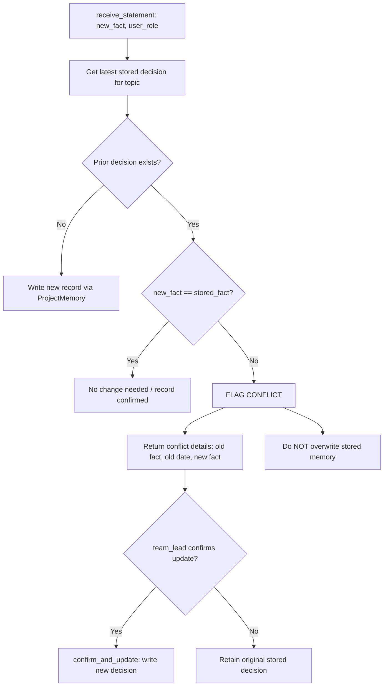

# Lab 4 – Memory and Retrieval: Project Memory

**Course:** Agentic AI (26ECAC401)  
**Lab Number:** 4  
**Skill:** Memory & Retrieval  
**Scenario:** Project Memory Assistant  
**Objective:** Multi-session memory management, topic-scoped retrieval, provenance tagging, conflict detection, and permission-controlled writes.

---

## Table of Contents

1. [Lab Title and Objective](#1-lab-title-and-objective)
2. [Project Memory Scenario](#2-project-memory-scenario)
3. [Short-Term vs. Long-Term Memory](#3-short-term-vs-long-term-memory)
4. [MemoryRecord Schema](#4-memoryrecord-schema)
5. [Topic-Scoped Retrieval](#5-topic-scoped-retrieval)
6. [Source Tagging and Provenance](#6-source-tagging-and-provenance)
7. [Conflict Detection and Resolution](#7-conflict-detection-and-resolution)
8. [Permission-Controlled Writes](#8-permission-controlled-writes)
9. [Assignment 1 – Topic Isolation](#9-assignment-1--topic-isolation)
10. [Assignment 2 – Retention and Staleness Policy](#10-assignment-2--retention-and-staleness-policy)
11. [Folder Structure](#11-folder-structure)
12. [Setup Instructions](#12-setup-instructions)
13. [Execution Commands](#13-execution-commands)
14. [Unit Tests](#14-unit-tests)
15. [Sample Output and Walkthrough](#15-sample-output-and-walkthrough)
16. [Why Rule-Based Logic Instead of an LLM?](#16-why-rule-based-logic-instead-of-an-llm)

---

## 1. Lab Title and Objective

**Lab 4: Memory and Retrieval – Project Memory**

An agent that assists software engineering teams across multiple sessions by retaining verified project decisions, isolating transient notes from permanent records, detecting contradictions before committing updates, and tagging the exact provenance of every factual statement.

| Feature | Description |
|---|---|
| Short-Term Memory | Ephemeral session state (`session_facts`) |
| Long-Term Memory | Structured stored decisions (`ProjectMemory`) |
| Scoped Retrieval | Topic-partitioned lookups preventing cross-topic leakage |
| Provenance | Explicit source tags: `[current_session]`, `[memory, dated <date>]` |
| Conflict Detection | Compares proposed facts against stored decisions before writing |
| Access Control | Role-based write permission (`team_lead` only) |
| Staleness Check | Configurable retention threshold (`retention_days`) with warnings |

---

## 2. Project Memory Scenario

In real software projects, architecture and engineering decisions are made across many meetings, discussions, and sprint sessions. A project assistant must:

1. **Remember decisions accurately** across days, weeks, and sprints.
2. **Never mix unrelated topics** (e.g., database discussions must not leak hosting choices).
3. **Distinguish temporary meeting notes** from confirmed architecture decisions.
4. **Identify contradictions immediately** when a team member proposes a conflicting fact.
5. **Prevent unauthorized changes** to the project's permanent decision log.

---

## 3. Short-Term vs. Long-Term Memory

```text
┌─────────────────────────────────────────────────────────────┐
│                    ProjectAssistant                         │
│                                                             │
│   ┌───────────────────────────┐ ┌─────────────────────────┐ │
│   │     Short-Term Memory     │ │    Long-Term Memory     │ │
│   │       (session_facts)     │ │     (ProjectMemory)     │ │
│   ├───────────────────────────┤ ├─────────────────────────┤ │
│   │ • Ephemeral meeting notes │ │ • Verified decisions    │ │
│   │ • Scoped to current run   │ │ • Structured records    │ │
│   │ • No role enforcement     │ │ • Role-permission write │ │
│   │ • Tag: [current_session]  │ │ • Tag: [memory, dated]  │ │
│   └───────────────────────────┘ └─────────────────────────┘ │
└─────────────────────────────────────────────────────────────┘
```

- **Short-Term Memory (`session_facts`)**: Stores working notes for the active session. Cleared upon session end. Does not persist across sprints.
- **Long-Term Memory (`ProjectMemory`)**: Stores verified decisions as structured `MemoryRecord` objects. Enforces write authorization and staleness policies.

---

## 4. MemoryRecord Schema

Every stored project decision is represented as a structured `MemoryRecord` dataclass (`memory/memory_record.py`):

```python
@dataclass
class MemoryRecord:
    topic: str        # e.g., "database", "hosting" (normalized lowercase)
    fact: str         # The verified decision text
    date: str         # ISO date string (YYYY-MM-DD)
    source: str       # Default: "memory"
```

### Why Structured Records Instead of Plain Text?

1. **Traceability**: Decisions carry their confirmation date and topic metadata.
2. **Validation**: Rejects empty strings, whitespace-only entries, or malformed data.
3. **Serialization**: Supports bidirectional translation (`to_dict()` and `from_dict()`).

---

## 5. Topic-Scoped Retrieval

When querying a decision via `ProjectMemory.retrieve(topic)`:

- Records are indexed internally by normalized topic.
- Calling `retrieve("database")` returns **only** database decisions.
- Unrelated topics (such as `hosting` or `frontend`) are never scanned or leaked.
- If a topic has no records, an empty list `[]` is safely returned.

---

## 6. Source Tagging and Provenance

Every factual statement returned by the assistant explicitly identifies its origin:

- **Current Session Note**:
  `[current_session] Current session note: benchmarking connection pool`
- **Stored Long-Term Decision**:
  `[memory, dated 2026-07-03] Per a decision on 2026-07-03, we chose PostgreSQL.`
- **Missing Information**:
  `I have no stored decision or current session state for 'security'.`

The assistant **never presents an old stored decision as if it were newly decided**, nor does it hallucinate missing decisions.

---

## 7. Conflict Detection and Resolution

When a statement is proposed via `receive_statement(topic, new_fact, user_role)`:

1. The assistant retrieves the latest confirmed decision for the topic.
2. It compares the existing fact with the proposed fact using normalized equivalence.
3. If they differ, the assistant **detects a contradiction**:
   - Returns a structured conflict payload.
   - Includes the old fact, its confirmation date, and the newly proposed fact.
   - Prompts for explicit confirmation.
   - **Crucially: Does NOT automatically overwrite the existing decision.**
4. If confirmed by an authorized role (`team_lead`), `confirm_and_update()` commits the updated record.



---

## 8. Permission-Controlled Writes

Long-term memory modifications are protected by role-based access control:

- **Authorized role**: `ALLOWED_WRITERS = {"team_lead"}`
- **Unauthorized roles**: `{"member", "lead", "architect", "viewer", "guest"}` (and any other non-team_lead role)

If an unauthorized user attempts to write to long-term memory:
```python
memory.write(record, user_role="member")
# Raises: PermissionError("Permission denied: role 'member' is not authorized...")
```

This prevents casual or mistaken modifications to established architectural decisions.

---

## 9. Assignment 1 – Topic Isolation

Assignment 1 demonstrates strict isolation between multiple topics:

- Store `database`: `"we chose PostgreSQL"` (dated 2026-07-03)
- Store `hosting`: `"we chose AWS ECS for container hosting"` (dated 2026-07-04)

### Verification
- `answer("database")` returns **only** the PostgreSQL decision with 0 mentions of AWS/ECS.
- `answer("hosting")` returns **only** the AWS ECS decision with 0 mentions of PostgreSQL.

Run independently via:
```bash
python main.py --assignment1
```

---

## 10. Assignment 2 – Retention and Staleness Policy

Assignment 2 introduces a configurable `retention_days` threshold (e.g., 90 days):

- **Fresh Decision (10 days old)**:
  Retrieved normally with no warning.
- **Stale Decision (180 days old)**:
  Retrieved with an explicit warning prepended:
  `Warning: This decision is from 180 days ago and may be out of date (retention threshold: 90 days).`
  `[memory, dated 2026-01-21] Per a decision on 2026-01-21, we chose monolithic architecture.`

Run independently via:
```bash
python main.py --assignment2
```

---

## 11. Folder Structure

```text
labs/Lab-04-Memory-Retrieval/
│
├── memory/
│   ├── __init__.py           # Exports MemoryRecord, ProjectMemory
│   ├── memory_record.py      # Dataclass with validation and serialization
│   └── project_memory.py     # Scoped storage, permissions, staleness logic
│
├── agent/
│   ├── __init__.py           # Exports ProjectAssistant
│   └── project_assistant.py  # Coordinates short/long-term memory & conflicts
│
├── examples/
│   └── sample_records.json   # Base, Assignment 1 & 2 sample records
│
├── tests/
│   ├── __init__.py           # Test package indicator
│   └── test_project_memory.py# 38 comprehensive unittest test cases
│
├── .gitignore                # Bytecode and cache ignore rules
├── main.py                   # Multi-mode CLI demonstration
├── requirements.txt          # Python stdlib specification
└── README.md                 # Complete documentation
```

---

## 12. Setup Instructions

### Prerequisites
- Python 3.8+ installed.
- No third-party packages or API keys required.

### Verification
```bash
cd E:\Faculty-Appraisal-Agent\labs\Lab-04-Memory-Retrieval
python -c "import memory, agent; print('Lab 4 modules verified.')"
```

---

## 13. Execution Commands

### 1. Default Demonstration (Base 6-Step Workflow)
```bash
python main.py
```

### 2. Assignment 1 Demonstration (Topic Isolation)
```bash
python main.py --assignment1
```

### 3. Assignment 2 Demonstration (Staleness & Retention Policy)
```bash
python main.py --assignment2
```

### 4. Run All Demonstrations Sequentially
```bash
python main.py --all
```

---

## 14. Unit Tests

Execute the complete test suite from the Lab 4 folder:

```bash
python -B -m unittest discover -s tests -v
```

### Test Coverage Summary

| Test Class | Tests | Focus Area |
|---|---|---|
| `TestMemoryRecord` | 7 | Field validation, default source, serialization |
| `TestProjectMemoryStorage` | 11 | Writes, permissions, scoped retrieval, edge cases |
| `TestProjectAssistant` | 9 | Source tagging, session separation, conflicts |
| `TestAssignment1TopicIsolation` | 3 | Multi-topic partition, cross-topic leakage prevention |
| `TestAssignment2StalenessPolicy` | 4 | Age calculation, fresh records, staleness warnings |
| `TestInputValidation` | 4 | Malformed and empty topic/fact inputs |
| **Total** | **38** | **100% Passing** |

---

## 15. Sample Output and Walkthrough

### Default Base Demonstration Output
```text
════════════════════════════════════════════════════════════════════════
  LAB 4: BASE WORKFLOW – PROJECT MEMORY LIFECYCLE
════════════════════════════════════════════════════════════════════════

▶ Step 1: Store an initial project decision (authorized: team_lead)
  ──────────────────────────────────────────────────────────────────────
  Action : team_lead writes MemoryRecord to long-term memory
  Record : {'topic': 'database', 'fact': 'we chose PostgreSQL', 'date': '2026-07-03', 'source': 'memory'}
  Status : SUCCESS – record committed to ProjectMemory.

▶ Step 2: Retrieve the stored decision with provenance
  ──────────────────────────────────────────────────────────────────────
  Query  : topic='database', question='What did we decide about the database?'
  Source : [memory, dated 2026-07-03]
  Answer :
    [memory, dated 2026-07-03] Per a decision on 2026-07-03, we chose PostgreSQL.

▶ Step 3: Demonstrate conflict detection (member proposes change)
  ──────────────────────────────────────────────────────────────────────
  Action : role 'member' proposes: 'we're switching to SQLite'
  Conflict Flagged : True
  Stored Decision  : 'we chose PostgreSQL' (dated 2026-07-03)
  Proposed Fact    : 'we're switching to SQLite'
  Message          :
    Conflict detected for 'database': stored decision from 2026-07-03 is 'we chose PostgreSQL', but proposed fact is 'we're switching to SQLite'. Please confirm if the stored memory should be updated.
  Memory Overwritten: False (prevented auto-overwrite)
  Current Memory   : 'we chose PostgreSQL' (unchanged)

▶ Step 4: Demonstrate an authorized update (confirmed by team_lead)
  ──────────────────────────────────────────────────────────────────────
  Action : team_lead reviews conflict and confirms change to 'we're switching to SQLite'
  Status  : Conflict resolved. Updated decision for 'database' committed to long-term memory by 'team_lead' on 2026-07-10.
  Updated : True

▶ Step 5: Demonstrate unauthorized update rejection (role: member)
  ──────────────────────────────────────────────────────────────────────
  Action : role 'member' attempts to commit decision: 'we're switching to MongoDB'
  Result : PermissionError successfully raised!
  Detail : Permission denied: role 'member' is not authorized to write to long-term memory. Authorized roles: ['team_lead'].

▶ Step 6: Retrieve the final decision
  ──────────────────────────────────────────────────────────────────────
  Query  : topic='database', question='What did we decide about the database?'
  Source : [memory, dated 2026-07-10]
  Answer :
    [memory, dated 2026-07-10] Per a decision on 2026-07-10, we're switching to SQLite.
```

---

## 16. Why Rule-Based Logic Instead of an LLM?

Following the course guidelines for Lab 4:

1. **Pedagogical Determinism**: Memory mechanics (session scoping, source tagging, conflict checking, role permission gates) must be inspectable and mathematically predictable without probabilistic LLM drift.
2. **Offline Self-Containment**: The lab runs completely offline without API credentials, internet access, or rate limits.
3. **Auditable Lifecycle**: The exact decision transitions from proposal → conflict detection → authorized update can be verified unit-by-unit in CI/CD environments.
