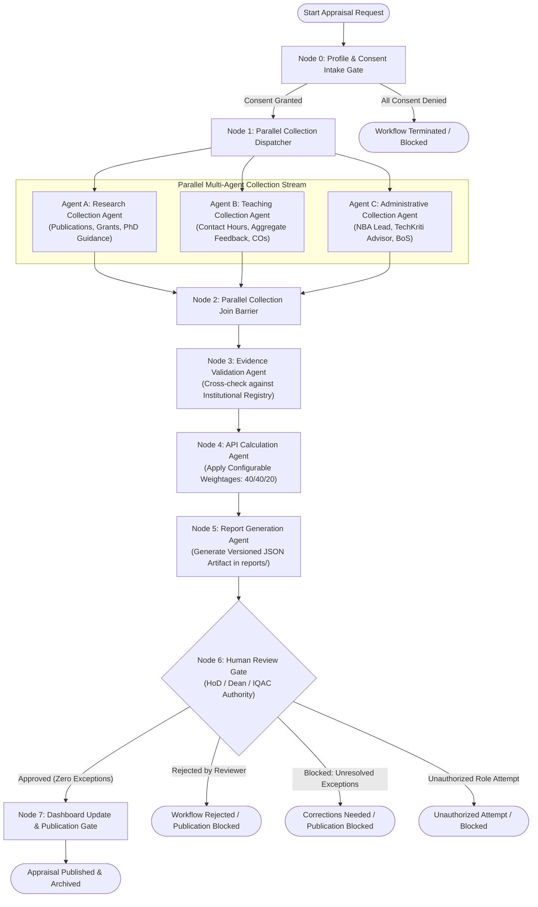

# Lab 7: Agentic Node Graph – Faculty Appraisal Management System

- **Course:** Agentic AI (26ECAC401)
- **Lab:** 7
- **Skill:** Agentic Node Graph Orchestration
- **Scenario:** Faculty Appraisal Management System
- **Objective:** Build a hybrid agentic node graph featuring parallel multi-agent data collection, institutional evidence validation, weighted API calculation, versioned appraisal reporting, and human-in-the-loop governance approval gates.

---

## 1. Executive Summary

Lab 7 implements a robust **Agentic Node Graph** for an institutional **Faculty Appraisal Management System**. In academic institutions, annual performance appraisal requires aggregating diverse metrics across Research, Teaching-Learning, and Administrative services, verifying documentary evidence (e.g., sanction orders, journal papers, student feedback certificates), computing Academic Performance Indicator (API) scores according to institutional weightages, and obtaining formal human governance approvals before final publication.

Rather than relying on a monolithic agent or a naive sequential chain, this lab orchestrates specialized agents in a **hybrid graph topology**:
- **Intake & Consent Gate:** Verifies faculty identity, role permissions, and categorical collection consent.
- **Parallel Collection Group:** Dispatches three specialized agents concurrently via Python's standard `concurrent.futures.ThreadPoolExecutor` to collect research publications, teaching hours, and institutional committee contributions.
- **Join & Evidence Validation Gate:** Merges parallel collection streams and cross-validates each activity claim against an official institutional evidence registry.
- **API Calculation Engine:** Enforces transparent, configurable category weightages (Research: 40%, Teaching: 40%, Administrative: 20%). Unverified claims contribute 0 points to verified totals and flag the score as `PROVISIONAL`.
- **Versioned Report Generator:** Distinguishes raw claims from verified metrics and writes structured JSON artifacts (`v1`, `v2`, etc.) to the `reports/` directory.
- **Human-in-the-Loop Approval Gate:** Restricts review authority strictly to authorized roles (`HoD`, `Dean`, `IQAC`). Enforces that reports with unresolved evidence exceptions cannot be approved.
- **Dashboard Publication Gate:** Only publishes the final dashboard and report when human approval is explicitly granted.

---

## 2. Architecture & Workflow Graph



---

## 3. Project Directory Structure

```text
labs/Lab-07-Agentic-Node-Graph/
├── README.md                      # Comprehensive Lab 7 documentation and guide
├── requirements.txt               # Dependencies declaration (Standard Library only)
├── main.py                        # Interactive CLI runner for all appraisal scenarios
├── agents/                        # Specialized agent node implementations
│   ├── __init__.py                # Package exports
│   ├── administrative_agent.py    # Group C: Administrative duties collection agent
│   ├── api_calculation_agent.py   # Group E: Weighted API scoring calculation agent
│   ├── coordinator.py             # Node 0: Central AURA graph coordinator
│   ├── evidence_validation_agent.py # Group D: Institutional evidence validation agent
│   ├── human_review_agent.py      # Group H: HoD / Dean / IQAC governance review agent
│   ├── report_generation_agent.py # Group F: Versioned JSON artifact reporting agent
│   ├── research_agent.py          # Group A: Research publications & grants agent
│   └── teaching_agent.py          # Group B: Teaching-learning & privacy feedback agent
├── data/                          # Mock institutional data sources & weightages
│   ├── mock_administrative.json   # Institutional roles, committee appointments, BoS
│   ├── mock_evidence.json         # Institutional evidence registry with checksums
│   ├── mock_research.json         # Research papers, grants, doctoral guidance
│   ├── mock_teaching.json         # Instruction hours, feedback index, CO attainment
│   └── weightages.json            # Configurable illustrative scoring weightages
├── examples/                      # Example test workflows & scenario configurations
│   └── sample_workflows.json      # Declarative test definitions for Scenarios A to F
├── graph/                         # Core agentic graph engine
│   ├── __init__.py                # Package exports
│   ├── graph_engine.py            # Graph orchestrator with ThreadPoolExecutor parallelism
│   ├── node.py                    # Graph Node abstraction and parallel group metadata
│   ├── state.py                   # Initial state factory and state cloning helpers
│   └── transitions.py             # Directed conditional edges and predicate evaluation
├── models/                        # Domain models and shared state schemas
│   ├── __init__.py                # Package exports
│   └── schemas.py                 # Activity, EvidenceRecord, ReviewDecision, WorkflowState
├── reports/                       # Persisted JSON appraisal report artifacts (v1, v2, ...)
└── tests/                         # Comprehensive unit & integration test suite (43 tests)
    ├── __init__.py                # Test package bootstrap with sys.path resolution
    ├── test_api_calculation.py    # Unit tests for weighted API calculation logic
    ├── test_collection_agents.py  # Unit tests for Research, Teaching, and Admin agents
    ├── test_end_to_end.py         # End-to-end integration tests for Scenarios A through F
    ├── test_evidence_validation.py # Unit tests for evidence status classification
    ├── test_graph_engine.py       # Unit tests for graph execution, transitions, cycles
    ├── test_human_review.py       # Unit tests for role governance and exception blocks
    ├── test_parallel_execution.py # Concurrency tests verifying ThreadPoolExecutor timing
    ├── test_report_generation.py  # Unit tests for report schema, versioning, artifacts
    └── test_security.py           # Unit tests for consent, privacy, and state isolation
```

---

## 4. State Schema & Lifecycle

### State Model (`models/schemas.py`)
The appraisal workflow operates over a central `WorkflowState` dataclass containing:
- `run_id`: Unique execution identifier (`RUN_<HEX>`).
- `faculty_id`, `faculty_name`, `appraisal_period`: Target profile context.
- `consent`: Explicit category consent dictionary (`research`, `teaching_learning`, `administrative`).
- `research_activities`, `teaching_activities`, `administrative_activities`: Collected activity claims.
- `collection_status`: Execution metrics (start, end, duration ms, status) for parallel nodes.
- `validated_activities`: Activities annotated with verification outcomes.
- `evidence_exceptions`: List of claims with validation exceptions.
- `api_score`: Detailed score breakdown (claimed vs verified, component weighted scores, provisional flag).
- `report`: Versioned appraisal summary artifact metadata.
- `review_decision`: Formal governance audit payload (`ReviewDecision`).
- `publication_status`: External visibility status (`NOT_PUBLISHED`, `APPROVED_AND_PUBLISHED`, `BLOCKED`).
- `audit_log`: Immutable append-only event log with ISO 8601 UTC timestamps.

### Workflow Lifecycle States
```text
INITIALIZED ──> COLLECTING ──> VALIDATED ──> SCORED ──> REPORT_GENERATED ──> AWAITING_APPROVAL
                                                                                     │
                       ┌─────────────────────────────────────────────────────────────┤
                       ▼                                                             ▼
           APPROVED_AND_PUBLISHED                                       BLOCKED / REJECTED
```

---

## 5. Specialized Agent Nodes

| Node Name | Group | Class | Role & Guardrails |
| :--- | :--- | :--- | :--- |
| `profile_intake` | Coordinator | `AURACoordinator:IntakeGate` | Verifies faculty identity, role permissions, and consent. If all consent flags are `False`, terminates workflow immediately. |
| `research_collection` | Group A | `ResearchAgent` | Collects publications, grants, and doctoral guidance. Verifies `consent['research']`. Flags incomplete claims missing title or claimed points. |
| `teaching_collection` | Group B | `TeachingAgent` | Collects instructional delivery hours, aggregate feedback, and CO attainment. Enforces student privacy guardrails (aggregate ratings only; no individual USNs or raw feedback). |
| `administrative_collection`| Group C | `AdministrativeAgent` | Collects committee roles, accreditation responsibilities, and institutional service. Validates official institutional source offices. |
| `parallel_collection_join` | Engine | `GraphEngine` | Coordinates concurrent execution of Groups A, B, and C in parallel threads, records per-thread execution durations, and merges state. |
| `evidence_validation` | Group D | `EvidenceValidationAgent` | Validates claims against `mock_evidence.json`. Classifies claims into `VERIFIED`, `MISSING_EVIDENCE`, `MISMATCHED_EVIDENCE`, or `INCOMPLETE`. |
| `api_calculation` | Group E | `APICalculationAgent` | Applies configurable category weightages. Excludes unverified claims from verified score. Flags score as `PROVISIONAL` if exceptions exist. |
| `report_generation` | Group F | `ReportGenerationAgent` | Compiles structured report distinguishing claimed vs verified metrics. Generates unique, non-overwriting artifacts `{faculty_id}_{period}_{scenario}_{run_id}_{version}.json` with automatic versioning (`v1`, `v2`, ...). |
| `human_review` | Group H | `HumanReviewAgent` | Enforces governance authorization: only `HoD`, `Dean`, and `IQAC` are allowed. Strictly blocks approval if unresolved evidence exceptions exist. |
| `dashboard_publication` | Coordinator | `AURACoordinator:PublishGate` | Final publication gate. Publishes dashboard and report only when human review decision is explicitly `APPROVED`. Otherwise sets status to `BLOCKED`. |

---

## 6. Parallel Execution Engine

In traditional sequential pipelines, each collection agent must wait for the preceding agent to finish. Lab 7 implements true multi-threaded concurrency using Python's standard `concurrent.futures.ThreadPoolExecutor`:

1. **Parallel Group Registration:** Nodes registered with `is_parallel_group_member=True` and `parallel_group_name="parallel_collection"` are grouped together.
2. **Concurrent Execution:** When `execute_parallel_group("parallel_collection", state)` is invoked, tasks are submitted to a thread pool with `max_workers = len(node_names)`.
3. **Execution Metrics Capture:** Each worker tracks `start_time`, `end_time`, and `duration_ms` using high-resolution monotonic clocks (`time.perf_counter()`).
4. **State Synchronization:** Parallel collection results are merged into the shared `WorkflowState`, and a consolidated `PARALLEL_JOIN_COMPLETE` audit entry is appended.

---

## 7. Evidence Validation & Exception Classification

The `EvidenceValidationAgent` inspects all claimed activities and cross-checks them against the institutional evidence registry (`mock_evidence.json`):

| Classification | Meaning | Guardrail Impact |
| :--- | :--- | :--- |
| `VERIFIED` | Document exists, valid status, matches `faculty_id`, and matches `category`. | Claim contributes 100% of claimed points to the verified category score. |
| `MISSING_EVIDENCE` | `evidence_ref` is blank or not found in institutional registry. | Contributes 0 to verified score; marks score `PROVISIONAL`; blocks human approval. |
| `MISMATCHED_EVIDENCE` | Document belongs to a different faculty member (`faculty_id` mismatch) or wrong category. | Contributes 0 to verified score; marks score `PROVISIONAL`; blocks human approval. |
| `INCOMPLETE` | Claim missing mandatory title or has non-positive points. | Contributes 0 to verified score; marks score `PROVISIONAL`; blocks human approval. |

---

## 8. Academic Performance Indicator (API) Weightage Model

The `APICalculationAgent` evaluates activities using institutional weightages defined in `data/weightages.json`:

$$\text{Category Weighted Score} = \text{Verified Points} \times \text{Weightage}$$

$$\text{Overall Verified API Score} = \sum (\text{Category Weighted Score})$$

### Configured Illustrative Weights (`data/weightages.json`)
- **Research (Category I):** $40\%$ ($0.40$)
- **Teaching-Learning (Category II):** $40\%$ ($0.40$)
- **Administrative & Institutional Service (Category III):** $20\%$ ($0.20$)

> **Disclaimer:** These weightages are illustrative mock figures configured for educational demonstration in Lab 7.

### Transparent Calculation Example (Scenario A)
- **Research:** $55.0\text{ raw points} \times 0.40 = 22.00\text{ verified score}$
- **Teaching:** $60.0\text{ raw points} \times 0.40 = 24.00\text{ verified score}$
- **Administrative:** $40.0\text{ raw points} \times 0.20 = 8.00\text{ verified score}$
- **Total Claimed Score:** $54.00$
- **Total Verified Score:** $54.00$
- **Status:** `FINALIZED_PENDING_APPROVAL` (Zero exceptions detected)

---

## 9. Human-in-the-Loop Governance & Role Authorization

To prevent automated systems from making unverified decisions affecting faculty careers:
1. **Authorized Governance Roles:** Only `HoD` (Head of Department), `Dean`, and `IQAC` (Internal Quality Assurance Cell) have review authority.
2. **Unauthorized Roles Blocked:** Submissions evaluated by unauthorized roles (e.g. `Student`, `Faculty_Peer`, `External_Guest`) are rejected with an `UNAUTHORIZED_REVIEW_ATTEMPT` audit entry.
3. **Unresolved Exceptions Gate:** Even an authorized reviewer cannot grant final approval if unresolved exceptions remain. The agent automatically downgrades the decision to `NEEDS_CORRECTION` and sets workflow status to `BLOCKED_ON_EXCEPTIONS`.

---

## 10. Privacy, Security & Compliance Guardrails

- **Faculty Consent Enforcement:** Faculty can grant or withhold consent per category (`state.consent`). If consent for a category is `False`, the agent skips data extraction and logs a `CONSENT_DENIED_SKIPPED` warning. If all consent flags are `False`, workflow terminates at intake.
- **Student Privacy Preservation:** Teaching evaluation datasets only contain aggregate indices (e.g., $4.65 / 5.0$ rating across 68 students). Personally Identifiable Information (USNs, student roll numbers, individual student comments) is strictly excluded.
- **State Isolation:** Each execution creates a pristine `WorkflowState` instance with an isolated `run_id`. Independent runs for different faculty members operate with zero memory contamination.
- **Immutable Audit Logging:** Every node execution, transition decision, exception, and approval appends a timestamped audit entry to `state.audit_log`.

---

## 11. Comparison: Lab 6 (OpenClaw Runtime) vs Lab 7 (Agentic Node Graph)

| Architectural Dimension | Lab 6: OpenClaw Runtime | Lab 7: Agentic Node Graph |
| :--- | :--- | :--- |
| **Primary Pattern** | Single-agent runtime lifecycle & event loop | Multi-agent hybrid node graph & workflow orchestration |
| **Topology** | Sequential tick-based event loop (`execute_task`) | Directed graph with sequential and parallel execution paths |
| **Execution Concurrency** | Single-threaded step-by-step tool dispatch | True multi-threaded concurrency via `ThreadPoolExecutor` |
| **Agent Specialization** | One generalist personal agent calling tools | Eight specialized agent nodes with distinct domain roles |
| **Evidence & Integrity** | Tool result observation without cross-source registry | Formal validation against institutional evidence registry |
| **Scoring & Weighting** | Not modeled | Mathematical API engine with configurable category weights |
| **Governance Gates** | Autonomous agent execution | Explicit human review gate (`HoD`, `Dean`, `IQAC`) |
| **Publication Policy** | Immediate console / memory return | Cryptographically audited publication gate |

---

## 12. Running the Lab

### Prerequisites
- Python 3.10+ (Standard library only; zero external pip dependencies).

### Command-Line Execution Options

```bash
# 1. Run Scenario A: Clean successful appraisal workflow (HoD Approved)
python main.py

# 2. Run Scenario B: Injects missing evidence claim (Provisional score, publication blocked)
python main.py --missing-evidence

# 3. Run Scenario C: Injects evidence belonging to another faculty (Publication blocked)
python main.py --mismatched-evidence

# 4. Run Scenario D: Simulates Dean rejection for unmet teaching contact hours
python main.py --human-rejection

# 5. Run Scenario E: Simulates faculty denying consent for Research collection
python main.py --consent-denied

# 6. Run Scenario F: Simulates unauthorized approval attempt by a Student
python main.py --unauthorized-reviewer

# 7. Run all Scenarios A through F with consolidated summary table
python main.py --all
```

---

## 13. Test Suite & Verification

The test suite contains **43 unit and integration tests** implemented exclusively with Python's standard `unittest` library:

| Test Module | Tests | Description |
| :--- | :--- | :--- |
| `tests/test_collection_agents.py` | 8 | Validates Research, Teaching, and Admin agents, privacy rules, and consent checks. |
| `tests/test_parallel_execution.py` | 3 | Verifies `ThreadPoolExecutor` concurrent execution, state merging, and duration tracking. |
| `tests/test_evidence_validation.py`| 5 | Tests `VERIFIED`, `MISSING_EVIDENCE`, `MISMATCHED_EVIDENCE`, and `INCOMPLETE` rules. |
| `tests/test_api_calculation.py` | 3 | Verifies category weight calculation, provisional score flags, and unverified point exclusion. |
| `tests/test_report_generation.py` | 3 | Validates report formatting, version increments (`v1`, `v2`), and JSON artifact creation. |
| `tests/test_human_review.py` | 6 | Tests `HoD`, `Dean`, `IQAC` approvals, rejections, unauthorized roles, and exception blocks. |
| `tests/test_graph_engine.py` | 4 | Tests node registration, conditional transitions, execution tracing, and step limits. |
| `tests/test_security.py` | 5 | Tests full consent denial, partial consent, student privacy, and multi-tenant isolation. |
| `tests/test_end_to_end.py` | 6 | Tests complete end-to-end execution of Scenarios A through F. |
| **Total** | **43** | **All 43 tests pass (100% passing).** |

### Running the Test Suite
```bash
# Run all tests via discover
python -m unittest discover -s tests -v

# Run individual test module
python tests/test_end_to_end.py -v
```

---

## 14. Sample Execution Output

### Execution Trace & API Score Output (`python main.py`)
```text
==============================================================================
  SCENARIO A: Full Successful Appraisal Workflow (HoD Approved)
==============================================================================

[1] Graph Execution Trace (Sequential & Parallel Nodes):
+------+---------------------------+------------+---------------+---------+
| Step | Node Name                 | Mode       | Duration (ms) | Status  |
+------+---------------------------+------------+---------------+---------+
| 1    | profile_intake            | SEQUENTIAL | 0.0           | SUCCESS |
| 2    | research_collection       | PARALLEL   | 0.8           | SUCCESS |
| 3    | teaching_collection       | PARALLEL   | 0.9           | SUCCESS |
| 4    | administrative_collection | PARALLEL   | 0.8           | SUCCESS |
| 5    | parallel_collection_join  | SEQUENTIAL | 3.0           | SUCCESS |
| 6    | evidence_validation       | SEQUENTIAL | 0.3           | SUCCESS |
| 7    | api_calculation           | SEQUENTIAL | 0.3           | SUCCESS |
| 8    | report_generation         | SEQUENTIAL | 0.6           | SUCCESS |
| 9    | human_review              | SEQUENTIAL | 0.0           | SUCCESS |
| 10   | dashboard_publication     | SEQUENTIAL | 0.0           | SUCCESS |
+------+---------------------------+------------+---------------+---------+

[2] Parallel Data Collection Metrics:
+---------------------------+---------+---------------+------------+
| Collector Node            | Status  | Duration (ms) | Start Time |
+---------------------------+---------+---------------+------------+
| research_collection       | SUCCESS | 0.8           | 16:26:58   |
| teaching_collection       | SUCCESS | 0.9           | 16:26:58   |
| administrative_collection | SUCCESS | 0.8           | 16:26:58   |
+---------------------------+---------+---------------+------------+

[3] Evidence Validation Summary:
    Total Activities Evaluated : 10
    Verified Claims            : 10
    Exceptions Detected        : 0

[4] Academic Performance Indicator (API) Score Breakdown:
    Score Status              : FINALIZED_PENDING_APPROVAL
    Is Provisional?           : False
    Overall Claimed Score     : 54.00
    Overall Verified Score    : 54.00
+-------------------+-------------+--------+------------------+--------------+----------------+
| Category          | Raw Claimed | Weight | Claimed Weighted | Verified Pts | Verified Score |
+-------------------+-------------+--------+------------------+--------------+----------------+
| Research          | 55.0        | 0.40   | 22.00            | 55.0         | 22.00          |
| Teaching_Learning | 60.0        | 0.40   | 24.00            | 60.0         | 24.00          |
| Administrative    | 40.0        | 0.20   | 8.00             | 40.0         | 8.00           |
+-------------------+-------------+--------+------------------+--------------+----------------+

[5] Human Review & Governance Gate:
    Reviewer ID     : REV_HOD_001
    Reviewer Role   : HoD
    Review Decision : APPROVED
    Reviewer Notes  : All activities verified against institutional records. Recommended for promotion.

[6] Final Publication & Dashboard Status:
    Workflow Status    : APPROVED_AND_PUBLISHED
    Publication Status : APPROVED_AND_PUBLISHED
    Report Artifact    : reports/FAC001_2025-2026_scenario_a_success_RUN_FECD8B3F_v1.json
```

### Consolidated Scenarios Summary (`python main.py --all`)
```text
==============================================================================
  CONSOLIDATED SUMMARY: ALL SCENARIOS
==============================================================================
+-------------------------------------+------------------------------+--------------------------+-----------+
| Scenario Name                       | Expected Status              | Actual Status            | Result    |
+-------------------------------------+------------------------------+--------------------------+-----------+
| Scenario A: Happy Path              | APPROVED_AND_PUBLISHED       | APPROVED_AND_PUBLISHED   | PASS [OK] |
| Scenario B: Missing Evidence        | BLOCKED                      | BLOCKED                  | PASS [OK] |
| Scenario C: Mismatched Evidence     | BLOCKED                      | BLOCKED                  | PASS [OK] |
| Scenario D: Dean Rejection          | BLOCKED (REJECTED)           | BLOCKED (REJECTED)       | PASS [OK] |
| Scenario E: Research Consent Denied | Research Skipped (0 records) | Research: 0, Teaching: 4 | PASS [OK] |
| Scenario F: Unauthorized Reviewer   | BLOCKED (REJECTED)           | BLOCKED (REJECTED)       | PASS [OK] |
+-------------------------------------+------------------------------+--------------------------+-----------+
```
