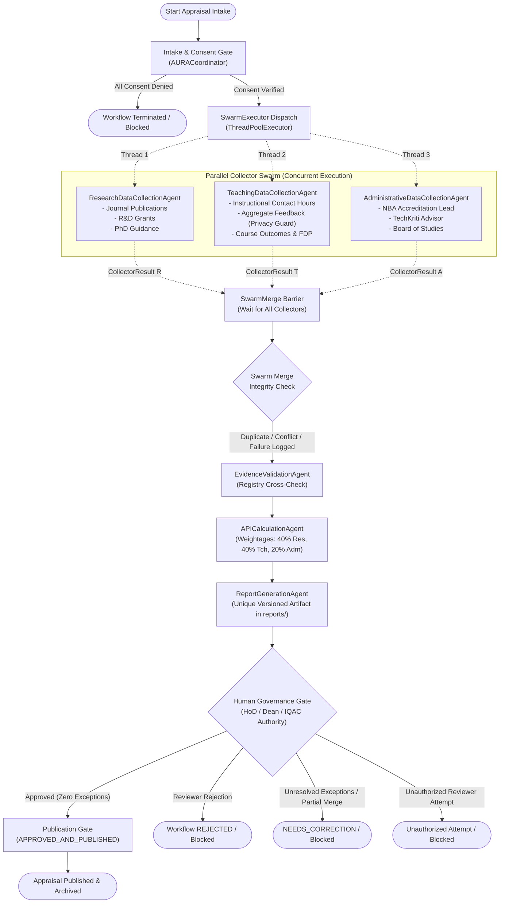

# Lab 8: Parallel Swarm – Faculty Appraisal Management System

- **Course:** Agentic AI (26ECAC401)
- **Lab:** 8
- **Pattern:** Parallel Multi-Agent Swarm Orchestration
- **Scenario:** Faculty Appraisal Management System (Institutional Performance Evaluation)
- **Objective:** Design and implement a genuine parallel multi-agent swarm architecture using Python's standard library `concurrent.futures.ThreadPoolExecutor` to collect disparate faculty appraisal metrics concurrently, merge them at a synchronized barrier with duplicate/conflict detection, validate documentary claims against an institutional evidence registry, compute transparent API scores, generate unique versioned audit reports, and enforce human governance approval gates.

---

## 1. Executive Summary

In higher education institutions, the annual faculty appraisal cycle requires aggregating large volumes of disparate performance data across multiple operational domains:
- **Research & Publications:** Peer-reviewed journal papers, sponsored R&D grants, doctoral student completions, and patents.
- **Teaching & Learning:** Direct classroom instructional hours, course outcome (CO) attainment, student pedagogical feedback ratings, and pedagogical training (FDP/workshops).
- **Administrative & Institutional Service:** Accreditation committees (NBA/NAAC), student co-curricular mentorship (e.g., TechKriti), and statutory academic boards (Board of Studies).

Relying on a single monolithic agent or a sequential linear pipeline introduces substantial performance bottlenecks, tight coupling, and cascading failures. If one metric source is slow or temporarily unavailable, the entire appraisal workflow stalls.

**Lab 8 solves this by deploying a Parallel Multi-Agent Swarm architecture:**
1. **Parallel Swarm Dispatch:** A central coordinator (`AURACoordinator`) dispatches three specialized collector agents simultaneously into a concurrent worker pool (`SwarmExecutor` using `concurrent.futures.ThreadPoolExecutor`).
2. **State Isolation During Collection:** Each collector runs in complete isolation with its own context, executing concurrently without shared mutable state, and writing to an independent `CollectorResult`.
3. **Synchronized Swarm Merge:** The coordinator synchronizes at a join barrier (`SwarmMerge`). It merges activities, preserves collector role and source citations, detects duplicate activity IDs and conflicting claims, and handles partial/failed collector runs without losing successfully collected data.
4. **Institutional Evidence Cross-Validation:** Downstream sequential validation cross-checks claimed activities against the registrar's official evidence registry, classifying claims into `VERIFIED`, `MISSING_EVIDENCE`, `MISMATCHED_EVIDENCE`, or `INCOMPLETE`.
5. **Configurable API Scoring:** Verified metrics are scored against institutional weightages (Research 40%, Teaching 40%, Administrative 20%). Unverified claims contribute zero points and trigger a `PROVISIONAL` score status.
6. **Unique Versioned Report Generation:** Generates non-overwriting JSON report artifacts in `reports/` with run IDs, scenario tags, and automatic version incrementing.
7. **Human-in-the-Loop Governance:** Restricts approval authority strictly to authorized governance roles (`HoD`, `Dean`, `IQAC`). Final appraisal publication is blocked if any evidence exceptions exist or if collection was incomplete.

---

## 2. Swarm Architecture & Execution Flow



---

## 3. Swarm vs. Node Graph Pattern (Lab 7 vs. Lab 8)

| Dimension | Lab 7: Agentic Node Graph | Lab 8: Parallel Swarm |
|---|---|---|
| **Topology** | Explicit state machine graph with conditional edge transitions | Autonomous parallel agent fan-out coordinated via a thread pool and join barrier |
| **Concurrency Mechanism** | Graph engine node-level threading across adjacent nodes | Dedicated `SwarmExecutor` (`ThreadPoolExecutor`) managing worker threads with isolated exception capture |
| **Worker Independence** | Nodes execute within a single shared state dictionary | Workers execute independently; each returns an isolated `CollectorResult` |
| **State Synthesis** | Nodes update state incrementally in graph transitions | Synchronized `SwarmMerge` barrier explicitly aggregates, deduplicates, and resolves conflicts |
| **Failure Tolerance** | Unhandled node errors can halt graph transition sequence | Worker failures are isolated into `CollectorResult(status="FAILED")`; partial results are preserved |
| **Downstream Pipeline** | Graph edges route to downstream nodes | Swarm collector results feed into downstream sequential validation, scoring, reporting, and review |

### Why Parallel Collection, Followed by Sequential Validation & Scoring?
- **Parallel Collection:** Each collector interacts with independent institutional data sources (Research repository, Student Information System, Dean's Office). Collecting in parallel cuts latency to `max(t_R, t_T, t_T)` instead of `t_R + t_T + t_A`.
- **Sequential Validation & Scoring:** Evidence validation and API scoring require a holistic, consolidated view of all activities to check total points, verify category constraints, and cross-reference institutional evidence registries. Running validation after merge guarantees that duplicates and conflicting claims are resolved before scoring occurs.

---

## 4. Concurrency & Execution Timeline

The parallel swarm uses Python's standard library `concurrent.futures.ThreadPoolExecutor`. Each collector runs in a separate thread. Start and end timestamps are recorded with millisecond precision to demonstrate execution overlap.

```text
[Parallel Swarm Execution Timeline]
Time (ms)  0ms -------- 20ms -------- 40ms -------- 60ms -------- 80ms -------- 100ms
Thread 1:  [=== Research Collector ===] (60ms)
Thread 2:  [======= Teaching Collector =======] (80ms)
Thread 3:  [==== Admin Collector ====] (50ms)
Barrier:                                             [ SwarmMerge Synchronization ] (81ms)
```

In automated unit tests (`tests/test_parallel_execution.py`), three simulated collectors each sleeping 0.05 seconds run concurrently in ~0.05–0.07 seconds total, proving true parallel dispatch rather than sequential execution (which would require 0.15+ seconds).

---

## 5. Collector Responsibilities & Privacy Guardrails

### 1. ResearchDataCollectionAgent
- **Domain:** Scholarly activities and sponsored research.
- **Metrics Collected:** Peer-reviewed journal publications (Q1/Scopus), externally funded R&D grants (e.g., SERB/DST), and doctoral completions.
- **Normalization:** Standardizes raw records into the unified `Activity` schema with category `"Research"`, institutional citations, and evidence references.
- **Consent:** Checks `faculty_consent["research"]`. If `False`, collection is skipped with status `"SKIPPED"` and 0 activities.

### 2. TeachingDataCollectionAgent
- **Domain:** Curricular instruction delivery, pedagogical efficacy, and faculty development.
- **Metrics Collected:** Direct contact instruction hours (lectures/labs), aggregate student feedback ratings, course outcome (CO) attainment percentages, and approved FDP/workshop certifications.
- **Privacy Guardrail (CRITICAL):** Under institutional data protection standards, **individual student identities (student names, registration IDs, USNs) must never be accessed or exposed**. The agent aggregates feedback at the cohort level (e.g., average rating 4.65/5.0 across 68 students) and automatically redacts any personal identifiers found in comments.

### 3. AdministrativeDataCollectionAgent
- **Domain:** Departmental administration, institutional governance, and student co-curricular activities.
- **Metrics Collected:** NBA/NAAC accreditation coordinator roles, national student symposium faculty advisor duties (TechKriti), and Board of Studies (BoS) membership.
- **Verification Citations:** Every record cites an authoritative institutional appointment order (e.g., Office of Dean Academics, HoD Order).

---

## 6. Swarm Merge & Integrity Engine

The `SwarmMerge` stage synchronizes parallel collector outputs before validation:
1. **Collector Result Preservation:** Retains collector role, status, execution duration, and source citations in `state.collector_results`.
2. **Duplicate Activity Detection:** Detects duplicate `activity_id` values across collectors without silently overwriting data.
3. **Conflicting Claim Detection:** Flags conflicting claims (e.g., identical activity claiming different point values).
4. **Failure & Partial Collection Handling:** If a collector encounters an exception (e.g., `FAIL_RESEARCH`), the error is captured into `CollectorResult(status="FAILED", error=...)`. Successfully collected outputs from other collectors are preserved. The merge status is marked `PARTIAL`, which propagates downstream to flag the score as provisional and block final publication.

---

## 7. Downstream Pipeline: Validation, Scoring, Reporting & Review

### EvidenceValidationAgent
Cross-checks each activity claim against `data/mock_evidence.json`:
- `VERIFIED`: Evidence reference exists, faculty ID matches, and category aligns.
- `MISSING_EVIDENCE`: Evidence reference cannot be found in the registry.
- `MISMATCHED_EVIDENCE`: Evidence exists but belongs to a different faculty member or different category.
- `INCOMPLETE`: Activity lacks required title, description, or points.

### APICalculationAgent
- Calculates category totals according to institutional weightages:
  - **Research:** 40% weight
  - **Teaching-Learning:** 40% weight
  - **Administrative:** 20% weight
- **Rule:** Unverified claims (`MISSING_EVIDENCE`, `MISMATCHED_EVIDENCE`, `INCOMPLETE`) contribute **0 points** to the verified score.
- **Provisional Status:** If any evidence exceptions exist or if swarm collection was partial/failed, `is_provisional` is set to `True`.
- **Partial Consent & Category Status:** When faculty withholds consent for a category, that category is marked `NOT_COLLECTED_CONSENT_DENIED` with `is_verified_zero = False` and `raw_claimed_points = None`. It is **never silently represented as a verified zero score**. The overall score is flagged `score_status = "CONSENT_LIMITED"` and `is_provisional = True`.

### ReportGenerationAgent
Generates unique, traceable JSON report artifacts in `reports/`:
- **Naming Pattern:** `{faculty_id}_{appraisal_period}_{scenario}_{run_id}_{version}.json`
- **Non-Overwrite Guarantee:** Each workflow execution generates a unique file. If a file collision occurs, the version number automatically increments (`_v1`, `_v2`, etc.).
- **Traceability:** Contains full audit trail, swarm timeline, collector results, verified vs. claimed scores, and reviewer signatures.
- **Category Transparency:** Report category summaries explicitly record `collection_status` (`COLLECTED` vs. `SKIPPED_CONSENT_DENIED`), whether each category is collected, and whether any zero is genuinely verified or omitted due to withheld consent.

### HumanReviewAgent & Governance Gate
- **Authorized Roles:** Only `HoD`, `Dean`, or `IQAC` may review appraisals. Attempts by unauthorized roles (e.g., `Student`) are rejected and audited.
- **Approval Pre-conditions:** Human reviewers **cannot approve** an appraisal if:
  1. Any evidence exceptions remain unresolved (`unresolved_count > 0`).
  2. Swarm collection was incomplete or failed (`merge_status in ('PARTIAL', 'FAILED')`).
  3. The appraisal is **consent-limited** (`is_consent_limited == True`), unless an explicit, authorized institutional policy or review override is validated. Ordinary final approval is blocked with `NEEDS_CORRECTION` and status `BLOCKED_ON_CONSENT`. No automatic override is ever invented.
- **Institutional Override Validation:** The agent validates caller-supplied institutional overrides against a defined mock registry of authorized governance authorities (`Academic_Council`, `Governing_Body`, `Dean_Academic_Affairs`, `Vice_Chancellor`), recognized statutory policy references (`STATUTE_POLICY_4.2_SABBATICAL_EXEMPTION`, etc.), and required justification. Overrides missing authorized credentials or presenting unauthorized roles/policies are strictly rejected and audited.
- **Simulation Disclaimer:** *This override validation is an educational mock simulation of institutional governance policies for Lab 8 hands-on demonstration. It does NOT claim production-grade security, cryptographic attestation, or SSO access control.*
- **Rejection Authority:** Authorized reviewers may reject an appraisal for substantive institutional reasons (e.g., contact hour shortages), transitioning the workflow to `REJECTED` and blocking publication.

---

## 8. Project Directory Structure

```text
labs/Lab-08-Parallel-Swarm/
├── README.md                      # Comprehensive Lab 8 documentation (this file)
├── requirements.txt               # Dependencies declaration (Standard Library only)
├── main.py                        # Interactive CLI runner for all appraisal scenarios
├── agents/                        # Specialized agent implementations
│   ├── __init__.py                # Package exports
│   ├── administrative_agent.py    # Administrative service collector agent
│   ├── api_calculation_agent.py   # Weighted API scoring calculation agent
│   ├── coordinator.py             # Central AURA workflow coordinator
│   ├── evidence_validation_agent.py # Institutional evidence validation agent
│   ├── human_review_agent.py      # Governance review agent (HoD, Dean, IQAC)
│   ├── report_generation_agent.py # Unique versioned JSON report generator
│   ├── research_agent.py          # Research & publications collector agent
│   └── teaching_agent.py          # Teaching-learning & student privacy collector agent
├── data/                          # Mock institutional databases & weightages
│   ├── mock_administrative.json   # Administrative committee & BoS records
│   ├── mock_evidence.json         # Institutional evidence registry with checksums
│   ├── mock_research.json         # Publications, grants, doctoral guidance
│   ├── mock_teaching.json         # Contact hours, aggregate feedback, CO attainment
│   └── weightages.json            # Configurable illustrative scoring weightages
├── examples/                      # Example workflow definitions
│   └── sample_workflows.json      # Declarative test definitions for Scenarios A to G
├── models/                        # Domain models and shared schemas
│   ├── __init__.py                # Package exports
│   └── schemas.py                 # Activity, CollectorResult, MergeResult, WorkflowState
├── reports/                       # Generated unique versioned report artifacts
├── swarm/                         # Core parallel swarm engine
│   ├── __init__.py                # Package exports
│   ├── audit.py                   # Structured immutable audit logger
│   ├── executor.py                # Concurrent ThreadPoolExecutor swarm dispatcher
│   ├── merge.py                   # Swarm merge barrier, deduplication & conflict engine
│   └── state.py                   # WorkflowState factory and isolation helpers
└── tests/                         # Comprehensive unit and integration test suite
    ├── __init__.py                # Test package initialization and path resolution
    ├── test_api_calculation.py    # API scoring, weightages & provisional flag tests
    ├── test_collection_agents.py  # Collector schemas, privacy & consent tests
    ├── test_end_to_end.py         # End-to-end integration tests for Scenarios A–G
    ├── test_evidence_validation.py # Evidence registry cross-validation tests
    ├── test_human_review.py       # Human governance authorization & block tests
    ├── test_merge.py              # SwarmMerge barrier, duplicates & failure tests
    ├── test_parallel_execution.py # ThreadPoolExecutor concurrency & timing overlap tests
    ├── test_report_generation.py  # Unique naming, non-overwrite & versioning tests
    └── test_security.py           # Consent enforcement & student privacy tests
```

---

## 9. Demonstration Scenarios

The test harness and CLI support seven comprehensive scenarios:

| Scenario | Name | Key Characteristic | Expected Outcome |
|---|---|---|---|
| **Scenario A** | Clean Success | All 3 collectors succeed, 10 activities verified, zero exceptions | `APPROVED_AND_PUBLISHED` (HoD Approved) |
| **Scenario B** | Missing Evidence | Research collector includes unverified paper (`EVID_NONEXISTENT_999`) | Score Provisional, Approval Blocked (`NEEDS_CORRECTION`), Publication `BLOCKED` |
| **Scenario C** | Mismatched Evidence | Teaching activity paired with Administrative evidence category | Category Mismatch Detected, Score Provisional, Publication `BLOCKED` |
| **Scenario D** | Collector Failure | Research collector encounters exception; Teaching & Admin outputs preserved | Swarm Merge `PARTIAL`, Successful Outputs Preserved, Publication `BLOCKED` |
| **Scenario E** | Consent Denied (Consent-Limited) | Faculty denies consent for Research collection; Research marked `NOT_COLLECTED_CONSENT_DENIED` (not verified zero), score flagged `CONSENT_LIMITED` | Approval Blocked (`NEEDS_CORRECTION`), Publication `BLOCKED` without explicit authorized override |
| **Scenario F** | Unauthorized Reviewer | Student role attempts to approve appraisal report | Unauthorized Role Rejected, Workflow `REJECTED`, Publication `BLOCKED` |
| **Scenario G** | Dean Rejection | Dean rejects appraisal due to contact hour shortfall | Workflow `REJECTED`, Publication `BLOCKED` |

---

## 10. Execution Guide

### Prerequisites
- Python 3.10 or higher.
- Standard library only — **no external pip packages, no API keys, no internet connection required**.

### Running Demonstrations via CLI
Navigate to the lab directory or run from the repository root:

```bash
# Run default clean scenario (Scenario A: HoD Approved)
python labs/Lab-08-Parallel-Swarm/main.py

# Run missing evidence scenario (Scenario B)
python labs/Lab-08-Parallel-Swarm/main.py --missing-evidence

# Run mismatched evidence scenario (Scenario C)
python labs/Lab-08-Parallel-Swarm/main.py --mismatched-evidence

# Run collector failure scenario (Scenario D: Partial Swarm)
python labs/Lab-08-Parallel-Swarm/main.py --collector-failure

# Run consent denied scenario (Scenario E)
python labs/Lab-08-Parallel-Swarm/main.py --consent-denied

# Run unauthorized reviewer scenario (Scenario F)
python labs/Lab-08-Parallel-Swarm/main.py --unauthorized-reviewer

# Run human reviewer rejection scenario (Scenario G: Dean Rejection)
python labs/Lab-08-Parallel-Swarm/main.py --human-rejection

# Execute ALL scenarios sequentially with a consolidated comparison table
python labs/Lab-08-Parallel-Swarm/main.py --all
```

---

## 11. Automated Verification & Test Results

Run the full automated test suite containing **50 unit and integration tests**:

```bash
python -m unittest discover -s labs/Lab-08-Parallel-Swarm/tests -v
```

### Actual Test Suite Execution Output
```text
test_clean_verified_scoring (test_api_calculation.TestAPICalculation.test_clean_verified_scoring) ... ok
test_consent_denied_category_not_represented_as_verified_zero (test_api_calculation.TestAPICalculation.test_consent_denied_category_not_represented_as_verified_zero) ... ok
test_genuinely_verified_zero_distinguished_from_consent_denied (test_api_calculation.TestAPICalculation.test_genuinely_verified_zero_distinguished_from_consent_denied) ... ok
test_partial_merge_forces_provisional_score (test_api_calculation.TestAPICalculation.test_partial_merge_forces_provisional_score) ... ok
test_unverified_claims_excluded_from_verified_score (test_api_calculation.TestAPICalculation.test_unverified_claims_excluded_from_verified_score) ... ok
test_administrative_agent_consent_denied (test_collection_agents.TestCollectionAgents.test_administrative_agent_consent_denied) ... ok
test_administrative_agent_structured_collection (test_collection_agents.TestCollectionAgents.test_administrative_agent_structured_collection) ... ok
test_research_agent_consent_denied (test_collection_agents.TestCollectionAgents.test_research_agent_consent_denied) ... ok
test_research_agent_structured_collection (test_collection_agents.TestCollectionAgents.test_research_agent_structured_collection) ... ok
test_teaching_agent_consent_denied (test_collection_agents.TestCollectionAgents.test_teaching_agent_consent_denied) ... ok
test_teaching_agent_structured_collection (test_collection_agents.TestCollectionAgents.test_teaching_agent_structured_collection) ... ok
test_teaching_agent_student_privacy_guardrail (test_collection_agents.TestCollectionAgents.test_teaching_agent_student_privacy_guardrail) ... ok
test_scenario_a_success (test_end_to_end.TestEndToEndScenarios.test_scenario_a_success) ... ok
test_scenario_b_missing_evidence (test_end_to_end.TestEndToEndScenarios.test_scenario_b_missing_evidence) ... ok
test_scenario_c_mismatched_evidence (test_end_to_end.TestEndToEndScenarios.test_scenario_c_mismatched_evidence) ... ok
test_scenario_d_collector_failure (test_end_to_end.TestEndToEndScenarios.test_scenario_d_collector_failure) ... ok
test_scenario_e_consent_denied (test_end_to_end.TestEndToEndScenarios.test_scenario_e_consent_denied) ... ok
test_scenario_e_with_authorized_institutional_override (test_end_to_end.TestEndToEndScenarios.test_scenario_e_with_authorized_institutional_override) ... ok
test_scenario_e_with_unauthorized_override_blocked (test_end_to_end.TestEndToEndScenarios.test_scenario_e_with_unauthorized_override_blocked) ... ok
test_scenario_f_unauthorized_reviewer (test_end_to_end.TestEndToEndScenarios.test_scenario_f_unauthorized_reviewer) ... ok
test_scenario_g_human_rejection (test_end_to_end.TestEndToEndScenarios.test_scenario_g_human_rejection) ... ok
test_incomplete_claim (test_evidence_validation.TestEvidenceValidation.test_incomplete_claim) ... ok
test_mismatched_category_evidence (test_evidence_validation.TestEvidenceValidation.test_mismatched_category_evidence) ... ok
test_mismatched_faculty_evidence (test_evidence_validation.TestEvidenceValidation.test_mismatched_faculty_evidence) ... ok
test_missing_evidence (test_evidence_validation.TestEvidenceValidation.test_missing_evidence) ... ok
test_verified_claim (test_evidence_validation.TestEvidenceValidation.test_verified_claim) ... ok
test_approval_blocked_on_consent_limited_appraisal (test_human_review.TestHumanReview.test_approval_blocked_on_consent_limited_appraisal) ... ok
test_approval_blocked_on_incomplete_collection (test_human_review.TestHumanReview.test_approval_blocked_on_incomplete_collection) ... ok
test_approval_blocked_on_unresolved_exceptions (test_human_review.TestHumanReview.test_approval_blocked_on_unresolved_exceptions) ... ok
test_approval_permitted_with_authorized_institutional_override (test_human_review.TestHumanReview.test_approval_permitted_with_authorized_institutional_override) ... ok
test_dean_approval_clean_report (test_human_review.TestHumanReview.test_dean_approval_clean_report) ... ok
test_dean_rejection (test_human_review.TestHumanReview.test_dean_rejection) ... ok
test_hod_approval_clean_report (test_human_review.TestHumanReview.test_hod_approval_clean_report) ... ok
test_invalid_or_unauthorized_override_rejected (test_human_review.TestHumanReview.test_invalid_or_unauthorized_override_rejected) ... ok
test_iqac_approval_clean_report (test_human_review.TestHumanReview.test_iqac_approval_clean_report) ... ok
test_unauthorized_role_rejected (test_human_review.TestHumanReview.test_unauthorized_role_rejected) ... ok
test_clean_merge_all_collectors (test_merge.TestSwarmMerge.test_clean_merge_all_collectors) ... ok
test_collector_failure_preserves_successful_outputs (test_merge.TestSwarmMerge.test_collector_failure_preserves_successful_outputs) ... ok
test_duplicate_activity_id_detection (test_merge.TestSwarmMerge.test_duplicate_activity_id_detection) ... ok
test_audit_log_captures_swarm_execution (test_parallel_execution.TestParallelExecution.test_audit_log_captures_swarm_execution) ... ok
test_concurrency_timing_overlap (test_parallel_execution.TestParallelExecution.test_concurrency_timing_overlap) ... ok
test_concurrent_execution_of_all_three_collectors (test_parallel_execution.TestParallelExecution.test_concurrent_execution_of_all_three_collectors) ... ok
test_multiple_workflow_runs_do_not_overwrite (test_report_generation.TestReportGeneration.test_multiple_workflow_runs_do_not_overwrite) ... ok
test_report_structure_and_artifact_creation (test_report_generation.TestReportGeneration.test_report_structure_and_artifact_creation) ... ok
test_report_versioning_within_workflow (test_report_generation.TestReportGeneration.test_report_versioning_within_workflow) ... ok
test_version_increment_on_disk_collision (test_report_generation.TestReportGeneration.test_version_increment_on_disk_collision) ... ok
test_all_consent_denied_terminates_workflow (test_security.TestSecurityAndGovernance.test_all_consent_denied_terminates_workflow) ... ok
test_partial_consent_enforcement (test_security.TestSecurityAndGovernance.test_partial_consent_enforcement) ... ok
test_state_isolation_between_runs (test_security.TestSecurityAndGovernance.test_state_isolation_between_runs) ... ok
test_student_privacy_redaction (test_security.TestSecurityAndGovernance.test_student_privacy_redaction) ... ok

----------------------------------------------------------------------
Ran 50 tests in 0.204s

OK
```
