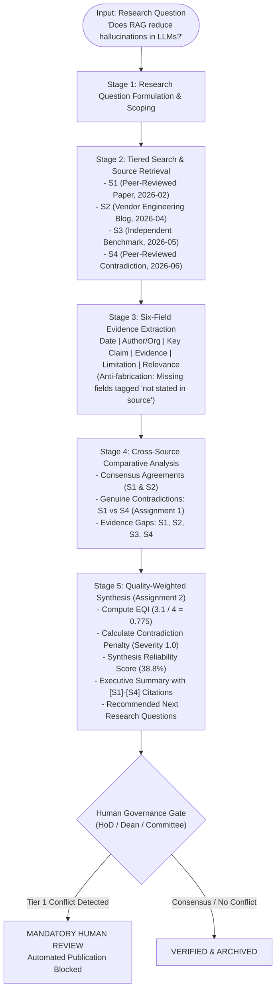

# Lab 9: Deep Research Agent – AI Topic Briefing

- **Course:** Agentic AI (26ECAC401)
- **Lab Number:** 9
- **Skill:** Deep Research & Evidence Synthesis
- **Scenario:** AI Topic Briefing (Faculty Appraisal Research Evaluation)
- **Objective:** Implement an autonomous Deep Research Agent that executes a five-stage research synthesis workflow (**Research Question → Search → Extract → Compare → Synthesize**), incorporates multi-tier evidence quality weighting, resolves direct empirical contradictions, preserves provenance, surfaces evidence gaps, and produces an auditable topic briefing artifact for human governance review.

---

## 1. Executive Summary

In higher education and research institutions, academic evaluation committees (Head of Department, Dean, IQAC, Research Council) must assess faculty research claims, technological proposals, and literature contributions. Relying solely on raw citation counts, search rankings, or unverified vendor claims leads to biased or unsubstantiated evaluations.

**Lab 9 introduces the Deep Research Agent**: an evidence-synthesis agent that objectively evaluates technical literature by executing a structured five-stage analytical pipeline:
1. **Research Question Scoping:** Formulates bounded technical queries.
2. **Tiered Source Retrieval:** Retrieves independent sources across defined quality tiers while strictly labeling mock demonstration fixtures.
3. **Structured Six-Field Extraction:** Extracts Source Date, Author/Organization, Key Claim, Evidence, Limitation, and Relevance without data fabrication.
4. **Cross-Source Comparison:** Identifies consensus agreements, isolates genuine contradictions from evidence gaps, and explains methodological root causes (Assignment 1).
5. **Quality-Weighted Synthesis:** Applies an explicit, reproducible mathematical weighting model to evaluate Evidence Quality Index (EQI) and synthesis reliability, fully disclosing lower-tier vendor claims while prioritizing peer-reviewed empirical evidence (Assignment 2), generating inline-attributed executive summaries and forward-looking research questions.

---

## 2. Five-Stage Deep Research Workflow Architecture



---

## 3. Official Source Fixtures (S1, S2, S3, S4)

All demonstration fixtures are maintained in `data/sources.json`. They are explicitly tagged with `is_synthetic: True` and `source_origin: "local_fixture"`.

| ID | Date | Source Type | Quality Tier & Weight | Title & Organization | Key Claim | Empirical Evidence | Stated Limitation | Relevance | Verification Status |
|---|---|---|---|---|---|---|---|---|---|
| **S1** | `2026-02` | Peer-reviewed paper | **Tier 1** ($w=1.0$) | *"Evaluating Factual Consistency in Retrieval-Augmented Generation"*, AI Systems Evaluation Group | RAG reduces factual hallucination rates by **41%** compared with non-retrieval baseline. | **200 held-out questions** from a medical knowledge base. | Small, single-domain dataset; results may not generalize to other domains. | Establishes a peer-reviewed empirical baseline for hallucination reduction in constrained factual QA. | Mock Demonstration Fixture |
| **S2** | `2026-04` | Vendor engineering blog | **Tier 3** ($w=0.4$) | *"Scaling Enterprise Retrieval: Practical Production Insights"*, Enterprise AI Platform Engineering Blog | RAG improves accuracy by **35%** across live enterprise workflows. | **Internal A/B test over 10,000 support tickets**. | Proprietary unreleased dataset; internal evaluation without baseline model parameter disclosure. | Real-world vendor operational claims; lower-tier evidence requiring disclosure without suppression. | Mock Demonstration Fixture |
| **S3** | `2026-05` | Independent benchmark report | **Tier 2** ($w=0.7$) | *"Latency Overhead and Inference Cost in Augmented Language Systems"*, Open Benchmark Consortium | RAG adds **200–400 ms latency** overhead per inference request. | **Benchmark across five open-source RAG pipelines** over 100k docs. | Evaluated on cloud benchmark infrastructure; accuracy and hallucination rates were not measured. | Quantifies computational latency trade-offs inherent in retrieval augmentation. | Mock Demonstration Fixture |
| **S4** | `2026-06` | Peer-reviewed research | **Tier 1** ($w=1.0$) | *"Retrieval-Augmented Generation Under Complex Multi-Hop Reasoning: An Empirical Contradiction"*, Reasoning Systems Laboratory | RAG does **NOT** reduce hallucination by 41%; hallucination rates **increase by 12% to 15%** under complex multi-hop reasoning. | Controlled empirical trial on **8,000 multi-hop reasoning questions** across 4 domains. | Focused strictly on multi-hop reasoning; simple single-hop lookups were excluded. | **Assignment 1 Contradiction:** Directly contradicts S1; demonstrates degradation when query complexity increases. | **Synthetic Demonstration Fixture** (Not independently verified) |

> [!NOTE]
> Per Assignment 1 guidelines, $S_4$'s peer-reviewed classification is illustrative for demonstrating multi-source conflict handling and is not presented as an independently verified real-world publication.

---

## 4. Official Assignment 1: Direct Contradiction Analysis ($S_1$ vs $S_4$)

Assignment 1 requires adding a fourth source ($S_4$) that directly contradicts the hallucination-reduction figure in $S_1$, distinguishing genuine conflict from a mere evidence gap and explaining the methodological root causes.

### 4.1 Conflict Identification: Genuine Contradiction vs. Evidence Gap
- **Evidence Gap:** A missing measurement, unstated sample size, or omission (e.g., $S_3$ measuring latency without measuring accuracy).
- **Genuine Contradiction:** Two sources test the same phenomenon (RAG hallucination impact) and report diametrically opposing empirical directional outcomes:
  - **$S_1$ Claim:** Factual hallucinations decrease by **41%** (positive grounding effect).
  - **$S_4$ Claim:** Factual hallucinations increase by **12% to 15%** (net negative distractor effect).

### 4.2 Methodological Root-Cause Analysis

| Dimension | Source 1 ($S_1$) | Source 4 ($S_4$) | Root Cause Explanation |
|---|---|---|---|
| **Task Complexity** | Single-hop direct fact retrieval | Multi-hop compositional reasoning | In single-hop queries, the top-1 retrieved chunk contains the exact answer. In multi-hop reasoning, disparate passages must be synthesized, and retrieving extraneous passages introduces distractors. |
| **Domain Scope** | Constrained single-domain (Medical QA) | Multi-domain (4 distinct domains) | Medical terms have unambiguous entity bindings. Diverse general reasoning domains feature polysemy and conceptual overlap where retrieval noise is elevated. |
| **Dataset Scale & Statistical Power** | 200 questions | 8,000 questions | Small sample sizes (200) can exhibit survivorship or selection bias. The 8,000-question scale exposes latent failure modes across challenging edge cases. |
| **Retrieval Noise Sensitivity** | High precision context | Distractor context injected | Irrelevant passages in the prompt confuse the model's self-attention heads, inducing generative hallucination. |

---

## 5. Official Assignment 2: Evidence-Quality Tiers & Weighting Policy

Assignment 2 establishes a quality tier hierarchy that assigns higher weight to higher-quality evidence while fully disclosing lower-quality evidence without suppression.

### 5.1 Quality Tier Hierarchy
- **Tier 1 ($w_1 = 1.0$):** Peer-reviewed research ($S_1, S_4$)
- **Tier 2 ($w_2 = 0.7$):** Independent benchmark reports ($S_3$)
- **Tier 3 ($w_3 = 0.4$):** Vendor engineering blogs and commercial whitepapers ($S_2$)

> [!IMPORTANT]
> **Disclosure Rule:** Tier 3 vendor evidence ($S_2$) is **never discarded or hidden**. It is displayed in the evidence table and discussed in the narrative summary, but carries discounted mathematical weight in aggregate confidence calculations.

### 5.2 Project Demonstration Policy Disclaimer
> **Policy Disclaimer:**  
> The Evidence Quality Index (EQI) and Synthesis Reliability formulas defined below represent **project-defined heuristic demonstration policies** for agentic reasoning and evaluation. They are not official UGC, governmental, or institutional regulatory formulas, nor do they represent mathematically validated probabilities.

### 5.3 Mathematical Formulation & Derivations

#### 1. Corpus Evidence Quality Index (EQI):
The arithmetic mean of tier weights across all $N$ evaluated sources:
$$\text{EQI} = \frac{\sum_{i=1}^{N} w(S_i)}{N}$$

For the full four-source corpus ($S_1, S_2, S_3, S_4$):
$$\text{EQI} = \frac{1.0 (S_1) + 0.4 (S_2) + 0.7 (S_3) + 1.0 (S_4)}{4} = \frac{3.1}{4} = 0.775$$

For the baseline three-source corpus ($S_1, S_2, S_3$):
$$\text{EQI}_{\text{baseline}} = \frac{1.0 (S_1) + 0.4 (S_2) + 0.7 (S_3)}{3} = \frac{2.1}{3} = 0.700$$

#### 2. Contradiction Severity:
When a genuine contradiction exists between two sources $S_a$ and $S_b$, severity is determined by the minimum tier weight of the conflicting pair:
$$\text{Severity}(S_a, S_b) = \min(w(S_a), w(S_b))$$

For the $S_1$ vs $S_4$ contradiction:
$$\text{Severity}(S_1, S_4) = \min(1.0, 1.0) = 1.0 \quad (\text{Direct Tier 1 Conflict})$$

#### 3. Synthesis Reliability Score:
The synthesis reliability penalizes the baseline EQI when severe empirical contradictions exist:
$$\text{Reliability Score} = \text{EQI} \times \left(1.0 - 0.5 \times \max_{(a,b) \in \text{Conflicts}} \text{Severity}(S_a, S_b)\right)$$

Evaluating for the four-source briefing:
$$\text{Reliability Score} = 0.775 \times (1.0 - 0.5 \times 1.0) = 0.775 \times 0.50 = 0.3875 \quad (38.8\%)$$

#### 4. Governance Trigger Rule:
- If $\max \text{Severity} \ge 1.0$:
  - `status = "CONTESTED_TIER_1_CONFLICT"`
  - `human_review_required = True`
  - Automated approval is blocked; human governance review (HoD/Dean) is mandatory.
- If $\max \text{Severity} < 1.0$:
  - `status = "CONVERGENT_WITH_CAVEATS"`
  - `human_review_required = False`

---

## 6. Six-Field Evidence Comparison Table

Extracted deterministically by `EvidenceExtractor`:

| Source ID | Tier & Weight | Date | Author / Organization | Key Claim | Evidence | Limitation | Relevance |
|:---:|:---:|:---:|:---|:---|:---|:---|:---|
| **S1** | Tier 1 (1.0) | `2026-02` | AI Systems Evaluation Group | RAG reduces hallucination by 41% | 200 held-out questions from a medical knowledge base | Small, single-domain dataset; results may not generalize to other domains | Establishes a peer-reviewed empirical baseline for hallucination reduction in constrained domain QA |
| **S2** | Tier 3 (0.4) | `2026-04` | Enterprise AI Platform Engineering Blog | RAG improves accuracy by 35% | Internal A/B test over 10,000 support tickets | Proprietary unreleased dataset, internal evaluation without baseline model disclosure | Demonstrates operational vendor claims and production accuracy metrics; lower-tier evidence requiring disclosure |
| **S3** | Tier 2 (0.7) | `2026-05` | Open Benchmark Consortium | RAG adds 200–400 ms latency | Benchmark across five open-source RAG pipelines | Cloud benchmark infrastructure only; factual accuracy and hallucination rates were not measured | Quantifies the computational latency trade-off inherent in deploying retrieval augmentation |
| **S4** | Tier 1 (1.0) | `2026-06` | Reasoning Systems Laboratory (Demonstration Fixture) | RAG does not reduce hallucination by 41%; hallucination rates increase by 12% to 15% on complex multi-hop reasoning tasks (Directly contradicts S1) | Controlled empirical trial on 8,000 multi-hop reasoning questions across 4 domains | Focused specifically on multi-hop reasoning; simple single-hop lookups were excluded | Direct Assignment 1 contradiction fixture to S1; demonstrates degradation when query complexity increases |

---

## 7. Cross-Source Analysis

### 7.1 Agreements & Consensuses
- **Factual Grounding in Constrained Domain QA (`[S1, S2]`):** Both $S_1$ and $S_2$ report positive gains in accuracy and factual grounding (41% hallucination reduction in $S_1$, 35% accuracy gain in $S_2$) when applied to straightforward, single-domain or customer support queries.
- **System Latency Overhead (`[S1, S2, S3]`):** Sources concur that shifting factual recall from static weights to dynamic index retrieval introduces external system dependencies and latency penalties (200–400 ms in $S_3$).

### 7.2 Genuine Contradictions (Assignment 1)
- **$S_1$ vs $S_4$ Conflict:** Direct contradiction regarding hallucination rate impact (+41% reduction in $S_1$ vs -12% to -15% reduction in $S_4$). Methodological root causes are fully analyzed across task complexity, domain scope, dataset size, and retrieval noise sensitivity.

### 7.3 Evidence Gaps
- **$S_1$:** Lacks cross-domain validation and serving latency measurements.
- **$S_2$:** Vendor unreleased evaluation data prevents independent reproduction.
- **$S_3$:** Benchmarks latency without evaluating factual accuracy or hallucination impact.
- **$S_4$:** Focuses strictly on multi-hop questions, omitting single-hop boundary validation.

---

## 8. Executive Summary & Recommended Next Questions

### Executive Summary (Attributed with Traceable Source IDs):
> Retrieval-Augmented Generation (RAG) demonstrates measurable utility for factual grounding in constrained, single-domain question-answering, achieving a 41% factual hallucination reduction in controlled medical evaluations `[S1]` and a 35% accuracy improvement in production support workflows `[S2]`. Per Assignment 2 evidence-quality tiering, Tier 3 vendor evidence `[S2]` is transparently disclosed alongside peer-reviewed findings, though discounted due to commercial interest and reliance on an unreleased proprietary dataset.
> 
> Operationally, independent benchmarking across five open-source RAG pipelines demonstrates that adding document retrieval imposes an empirical latency overhead of 200–400 ms per inference request `[S3]`. This latency penalty must be budgeted into interactive institutional applications.
> 
> Crucially, empirical findings diverge when reasoning complexity increases beyond single-hop lookups. In controlled evaluations over 8,000 multi-hop reasoning questions across four domains, RAG did not reduce hallucinations; instead, factual hallucination rates increased by 12% to 15% due to distracting irrelevant context `[S4]`. This represents a genuine empirical contradiction against S1's single-domain 41% reduction figure `[S1]`, attributable to differences in reasoning depth (single-hop vs. multi-hop), dataset scale (200 vs. 8,000 queries), and retrieval noise vulnerability.
> 
> Because a direct contradiction exists between Tier 1 research fixtures (`[S1]` vs `[S4]`), the overall synthesis reliability is penalized to 38.8% (`CONTESTED_TIER_1_CONFLICT`). Automated endorsement for academic appraisal or mission-critical workflows is blocked; mandatory Human-in-the-Loop review by the appraisal committee (HoD / Dean) is required.

### Recommended Next Questions:
1. *Algorithmic Mitigation:* What reranking, context-filtering, or graph-RAG techniques effectively eliminate the 12–15% multi-hop distraction penalty identified in `[S4]` without discarding essential context?
2. *Trade-off Optimization:* For institutional faculty appraisal workflows, does the 35–41% factual gain `[S1, S2]` justify the 200–400 ms latency overhead `[S3]` in concurrent multi-user environments?
3. *Cross-Domain Benchmarking:* What standardized cross-domain evaluation benchmark can be established to map the exact boundary condition where retrieval augmentation transitions from beneficial `[S1]` to counter-productive `[S4]`?
4. *Vendor Transparency:* How can vendor-reported improvements (e.g., 35% in `[S2]`) be independently verified using open-source datasets and transparent baseline model configurations?

---

## 9. Faculty Appraisal System Integration & Governance

In the **Faculty Appraisal Management System**:
- **Objective Research Claim Assessment:** When a faculty member claims that implementing RAG in campus portals or academic research eliminated hallucinations, review committees use the Deep Research Agent to evaluate the claim against tiered literature.
- **Preventing Premature Adoption:** Counter-evidence (`[S4]`) and latency overheads (`[S3]`) prevent committees from unthinkingly accepting unverified vendor claims (`[S2]`) or small-sample studies (`[S1]`).
- **Human-in-the-Loop Gate:** A Tier 1 conflict (`[S1]` vs `[S4]`) automatically halts automated endorsement, requiring human HoD/Dean deliberation.
- **Non-Destructive Boundary:** All Lab 9 logic is strictly self-contained in `labs/Lab-09-Deep-Research/`. It leaves backend scoring, database models, and Labs 1–8 untouched.

---

## 10. Project Directory Structure

```text
labs/Lab-09-Deep-Research/
├── README.md                          # Comprehensive documentation, theory, assignments, and guide
├── requirements.txt                   # Standard Library only (Python 3.12+)
├── main.py                            # Interactive CLI runner for all demonstration scenarios
├── agent/                             # Core Deep Research Agent components
│   ├── __init__.py                    # Module exports
│   ├── deep_research_agent.py         # Main orchestrator (5-stage workflow)
│   ├── search_retriever.py            # Tiered retriever (mock & synthetic fixture loader)
│   ├── extractor.py                   # Six-field structured evidence extractor
│   ├── comparator.py                  # Cross-source comparator (agreements, S1 vs S4 conflict, gaps)
│   └── synthesizer.py                 # Quality-weighted executive synthesizer with formulas
├── data/                              # Official fixtures & tier configuration
│   ├── __init__.py
│   ├── sources.json                   # Official S1, S2, S3, S4 JSON definitions
│   └── quality_tiers.json             # Tier weights (Tier 1: 1.0, Tier 2: 0.7, Tier 3: 0.4) & rules
├── models/                            # Strongly typed domain schemas
│   ├── __init__.py
│   └── schemas.py                     # SourceDocument, EvidenceRow, ConflictRecord, EvidenceGap, BriefingReport
├── examples/                          # Scenario configurations
│   ├── __init__.py
│   └── sample_topics.json             # Declarative test topics (RAG Topic Briefing, Faculty Appraisal Claim)
├── tests/                             # Comprehensive unittest test suite (26 tests)
│   ├── __init__.py
│   ├── test_retriever.py              # Retrieval, mock/synthetic flags, query filtering
│   ├── test_extractor.py              # Six-field extraction completeness & anti-fabrication
│   ├── test_comparator.py             # S1 vs S4 contradiction detection & root-cause explanations
│   ├── test_quality_tiers.py          # Mathematical formula verification & tier weighting
│   ├── test_synthesizer.py            # Summary generation, citation integrity [S1]-[S4], next questions
│   └── test_end_to_end.py             # Full 5-stage pipeline integration & scenario tests
└── reports/                           # Output artifacts directory for generated briefings
    └── .gitkeep
```

---

## 11. Execution & Verification Commands

### 11.1 Run Lab 9 Unit Tests
```powershell
python -m unittest discover -s labs/Lab-09-Deep-Research/tests -t labs/Lab-09-Deep-Research
```

### 11.2 Execute the Interactive CLI Runner
```powershell
# Run all scenarios and generate artifacts in reports/
python labs/Lab-09-Deep-Research/main.py --scenario all

# Run specific scenarios
python labs/Lab-09-Deep-Research/main.py --scenario topic_01
python labs/Lab-09-Deep-Research/main.py --scenario topic_02
python labs/Lab-09-Deep-Research/main.py --scenario topic_03
```

### 11.3 Regression Verification across Labs 1–8
```powershell
python -m unittest discover -s labs/Lab-01-Agent-vs-Chatbot/tests
python -m unittest discover -s labs/Lab-02-Tool-Using-Agent/tests
python -m unittest discover -s labs/Lab-03-Skill-Creation/tests
python -m unittest discover -s labs/Lab-04-Memory-Retrieval/tests
python -m unittest discover -s labs/Lab-05-MCP-Connector/tests -t labs/Lab-05-MCP-Connector
python -m unittest discover -s labs/Lab-06-OpenClaw-Runtime/tests -t labs/Lab-06-OpenClaw-Runtime
python -m unittest discover -s labs/Lab-07-Agentic-Node-Graph/tests
python -m unittest discover -s labs/Lab-08-Parallel-Swarm/tests
```
