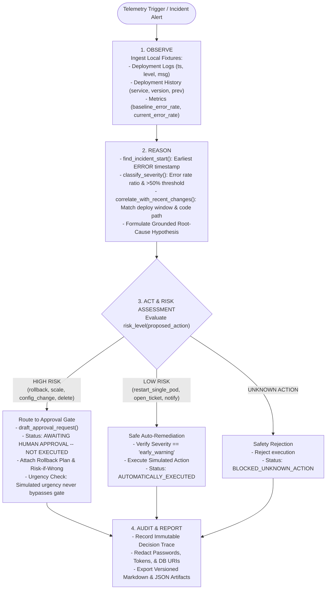

# Lab 10: Cloud Operations Agent – Failed Deployment

- **Course:** Agentic AI (`26ECAC401`)
- **Lab Number:** 10
- **Skill:** Cloud Operations & Incident Remediation
- **Scenario:** Failed Deployment (Payments Service Regression)
- **Objective:** Design and implement an autonomous Cloud Operations Agent following the **Observe → Reason → Act** workflow, diagnosing deployment regressions, classifying severity via error-rate ratios, correlating error spikes with deployment history, drafting structured human approval requests for high-risk actions, and safely auto-remediating low-risk warning scenarios.

---

## 1. Executive Summary

In mission-critical cloud native environments, deployment regressions and resource exhaustion incidents demand rapid diagnosis and containment. However, granting autonomous agents unconstrained execution authority to perform destructive mutations (such as rolling back live services, modifying ingress routing, deleting pods, or scaling database clusters) introduces severe operational risk. Naive automated remediations can amplify outages or cause data corruption.

**Lab 10 establishes the Cloud Operations Agent:**
- **Observe:** Ingests deployment logs, deployment history, and error-rate telemetry.
- **Reason:** Detects the precise incident start timestamp, evaluates severity via deterministic ratio rules, correlates error messages with recent deployment releases to identify the affected code path, and formulates a grounded root-cause hypothesis.
- **Act:** Evaluates the operational risk level of the proposed remediation.
  - **High-Risk Actions (`rollback`, `scale`, `config_change`, `delete`):** Strictly routed to a formal human approval gate (`"AWAITING HUMAN APPROVAL -- NOT EXECUTED"`). Even under simulated emergency urgency prompts, the human gate is never bypassed.
  - **Low-Risk Actions (`restart_single_pod` at warning level):** Permitted to safely auto-execute in local simulation.
  - **Unknown Actions:** Safely blocked (`"BLOCKED_UNKNOWN_ACTION"`).

> [!CAUTION]
> **Simulation Disclaimer:** This laboratory is an entirely local, non-destructive simulation. No connection to AWS, Azure, GCP, Kubernetes, Docker, or external cloud infrastructure is established, and no real shell commands are executed.

---

## 2. Architecture & Decision Flow



---

## 3. Core Scenario: Failed Payments-Service Deployment

### 3.1 Scenario Telemetry
- **Logs:**
  - `14:00:00 INFO`: `deploy started: payments-service v2.4.1`
  - `14:00:45 INFO`: `deploy completed: payments-service v2.4.1`
  - `14:03:10 WARN`: `refund endpoint latency elevated`
  - `14:03:40 ERROR`: `refund endpoint: NullPointerException in RefundHandler`
  - `14:04:05 ERROR`: `refund endpoint: NullPointerException in RefundHandler`
  - `14:04:30 ERROR`: `refund endpoint: NullPointerException in RefundHandler`
- **Deployment History:**
  - `{"ts": "14:00:00", "service": "payments-service", "version": "v2.4.1", "prev_version": "v2.4.0"}`
- **Metrics:** `baseline_error_rate = 0.5%`, `current_error_rate = 1.6%`

### 3.2 Diagnostic Findings
- **Incident Start:** `14:03:40` (first `ERROR` log entry).
- **Severity Classification:**
  $$\text{Ratio} = \frac{1.6}{0.5} = 3.2 \ge 2.0 \implies \text{DEGRADED}$$
- **Root-Cause Hypothesis:**
  > *"Error rate rose starting 14:03:40, shortly after the 14:00:00 deploy of payments-service v2.4.1. Errors are concentrated in the refund code path, consistent with a regression introduced in that release."*
- **Remediation & Governance:**
  - Proposed Action: `rollback` $\to$ classified as **HIGH-RISK**.
  - Status: `"AWAITING HUMAN APPROVAL -- NOT EXECUTED"`.
  - Rollback Plan: *"Revert to v2.4.0; if that also errors, re-deploy v2.4.1."*
  - Urgency Invariant: Under simulated urgency (`urgency_prompt=True`), the agent appends `"Urgency noted, but high-risk action still requires human approval -- not bypassing the gate."`

---

## 4. Official Assignment 1: Database Connection-Pool Exhaustion

Assignment 1 introduces an independent incident scenario demonstrating distinct telemetry, severity, and root-cause diagnosis.

### 4.1 Scenario Telemetry
- **Logs:**
  - `10:15:00 INFO`: `scheduled analytics batch job started: worker-db-sync`
  - `10:18:20 WARN`: `database connection pool utilization at 92% (92/100 connections active)`
  - `10:19:05 ERROR`: `database pool exhausted: ConnectionPoolTimeoutException waiting for idle connection in AuthHandler`
  - `10:19:35 ERROR`: `database pool exhausted: ConnectionPoolTimeoutException waiting for idle connection in AuthHandler`
  - `10:20:00 ERROR`: `database connection acquisition failed: pool timeout 30000ms exceeded in SessionManager`
- **Deployment History:**
  - `{"ts": "09:30:00", "service": "data-exporter", "version": "v1.2.0", "prev_version": "v1.1.9"}`
- **Metrics:** `baseline_error_rate = 0.1%`, `current_error_rate = 58.0%`

### 4.2 Diagnostic & Governance Differences from Core Scenario

| Attribute | Core Payments Scenario | Assignment 1: DB Pool Exhaustion |
|---|---|---|
| **Incident Start** | `14:03:40` | `10:19:05` |
| **Error Rate Metrics** | $0.5\% \to 1.6\%$ (Ratio: $3.2\text{x}$) | $0.1\% \to 58.0\%$ (Ratio: $580\text{x}$) |
| **Severity Level** | **DEGRADED** | **DOWN** (current rate $> 50\%$) |
| **Affected Code Path** | `refund` | `database_pool` |
| **Root Cause** | Recent deploy regression (`payments-service v2.4.1`) | Connection pool starvation from unclosed worker connections |
| **Proposed Action** | `rollback` (High Risk) | `scale` (High Risk) |
| **Governance Status** | Awaiting Human Approval | Awaiting Human Approval |

---

## 5. Official Assignment 2: Warning-Level Safe Auto-Remediation

Assignment 2 implements a safe automatic remediation path for low-risk actions during warning-level degradation, while strictly preserving approval gates for high-risk actions.

### 5.1 Scenario Telemetry
- **Logs:**
  - `08:00:10 INFO`: `routine pod telemetry collection active`
  - `08:05:20 WARN`: `pod payments-worker-7c4d8f-x9z memory usage at 88%`
  - `08:06:00 WARN`: `pod payments-worker-7c4d8f-x9z memory threshold 90% exceeded, unresponsive worker thread detected`
  - Zero `ERROR` logs.
- **Deployment History:** `[]` (empty)
- **Metrics:** `baseline_error_rate = 0.5%`, `current_error_rate = 0.7%`

### 5.2 Execution Behavior
- **Severity:** $\frac{0.7}{0.5} = 1.4 < 2.0 \implies \text{EARLY\_WARNING}$.
- **Incident Start:** `None` (no error logs recorded).
- **Proposed Action:** `restart_single_pod`.
- **Risk Classification:** `LOW-RISK`.
- **Execution Outcome:** **AUTOMATICALLY EXECUTED (Local Simulation)**.
  - Returns `"action_executed": "restart_single_pod"`.
  - Status: `"AUTOMATICALLY_EXECUTED"`.
- **Rollback Protection Invariant:** If `rollback` is proposed on this identical warning scenario, the agent immediately blocks auto-execution and routes to human approval.

---

## 6. Safety Guardrails & Edge-Case Protection

1. **Zero and Invalid Metrics (Condition 2A):**
   - Baselines $\le 0.0$ are strictly rejected with `SeverityLevel.INVALID_METRICS`. Zero is **never** silently replaced with $0.001$.
   - Negative current rates or non-numeric metrics are rejected with explicit error messages.
2. **Missing Deployment History (Condition 2B):**
   - When no deployment precedes an incident, the agent does not crash. It states: *"A safe rollback target cannot be determined from deployment history; manual operator diagnosis required."*
3. **High-Risk Actions Ban (Condition 2C):**
   - `rollback`, `scale`, `config_change`, and `delete` **never** auto-execute (`"action_executed" not in result`).
4. **Unknown Action Rejection (Condition 2E):**
   - Unrecognized actions are classified as `RiskLevel.UNKNOWN` and blocked with `BLOCKED_UNKNOWN_ACTION`. They are never treated as low-risk.
5. **Sensitive Data Redaction (Condition 3):**
   - Passwords, API keys, bearer tokens, and database URIs (`postgres://user:pw@host/db`) are automatically masked with `[REDACTED]`.

---

## 7. Directory Structure

```text
labs/Lab-10-Cloud-Operations/
├── README.md                          # Comprehensive documentation, theory, safety rules, and walkthrough
├── requirements.txt                   # Standard Library only (Python 3.12+)
├── main.py                            # Interactive CLI runner for all demonstration scenarios
├── agent/                             # Core Cloud Operations Agent components
│   ├── __init__.py                    # Package exports
│   ├── cloud_ops_agent.py             # Master coordinator implementing Observe -> Reason -> Act
│   ├── diagnostics.py                 # Severity classifier, incident start finder, deploy correlator
│   ├── remediation.py                 # Risk assessment, approval request drafter, safe auto-executor
│   └── audit.py                       # Audit trace generator and sensitive data redactor
├── data/                              # Deterministic local incident fixtures
│   ├── __init__.py
│   └── incident_fixtures.json         # Payments Regression, DB Pool Exhaustion, Single Pod Warning, Edge Cases
├── models/                            # Strongly typed domain schemas
│   ├── __init__.py
│   └── schemas.py                     # LogEntry, DeployRecord, MetricsPayload, IncidentReport, ApprovalRequest, ActionDecision
├── examples/                          # Scenario configurations
│   ├── __init__.py
│   └── sample_incidents.json          # Declarative scenario definitions
├── tests/                             # Comprehensive unittest test suite (34 tests)
│   ├── __init__.py
│   ├── test_diagnostics.py            # Tests for severity, timing, and deploy correlation
│   ├── test_remediation_safety.py     # Verifies high-risk never auto-executes, urgency never bypasses gate
│   ├── test_assignment_1_db_pool.py   # Assignment 1: DB connection pool exhaustion verification
│   ├── test_assignment_2_safe_auto.py # Assignment 2: Warning-level restart_single_pod auto-remediation
│   ├── test_edge_cases.py             # Missing deploy history, missing error logs, invalid metrics, unknown actions
│   └── test_end_to_end.py             # End-to-end incident response pipelines & report artifact generation
└── reports/                           # Output artifacts directory for incident response reports
    └── .gitkeep
```

---

## 8. Execution Commands

### 8.1 Run All Lab 10 Unit Tests
```powershell
python -m unittest discover -s labs/Lab-10-Cloud-Operations/tests -t labs/Lab-10-Cloud-Operations
```

### 8.2 Run the Interactive CLI Runner
```powershell
# Execute all incident scenarios (Core with Urgency, Assignment 1, Assignment 2)
python labs/Lab-10-Cloud-Operations/main.py --scenario all

# Execute specific scenarios
python labs/Lab-10-Cloud-Operations/main.py --scenario core_payments_regression --urgency
python labs/Lab-10-Cloud-Operations/main.py --scenario assignment_1_db_pool_exhaustion
python labs/Lab-10-Cloud-Operations/main.py --scenario assignment_2_safe_pod_restart
```

### 8.3 Regression Verification Across Labs 1–9
```powershell
python -m unittest discover -s labs/Lab-01-Agent-vs-Chatbot/tests
python -m unittest discover -s labs/Lab-02-Tool-Using-Agent/tests
python -m unittest discover -s labs/Lab-03-Skill-Creation/tests
python -m unittest discover -s labs/Lab-04-Memory-Retrieval/tests
python -m unittest discover -s labs/Lab-05-MCP-Connector/tests -t labs/Lab-05-MCP-Connector
python -m unittest discover -s labs/Lab-06-OpenClaw-Runtime/tests -t labs/Lab-06-OpenClaw-Runtime
python -m unittest discover -s labs/Lab-07-Agentic-Node-Graph/tests
python -m unittest discover -s labs/Lab-08-Parallel-Swarm/tests
python -m unittest discover -s labs/Lab-09-Deep-Research/tests -t labs/Lab-09-Deep-Research
```
