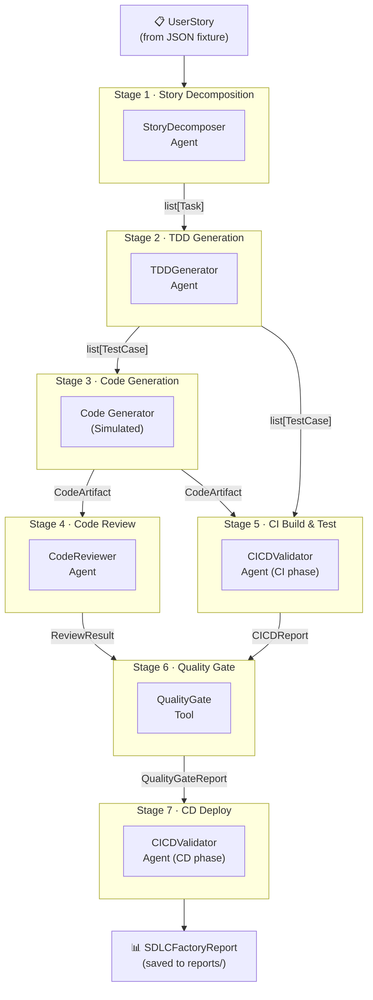

# Lab 11 — Agentic SDLC Factory

> **Autonomous Software Engineering Pipeline**
> Automating user story decomposition, test-driven code generation, and CI/CD validation.

---

## Overview

Lab 11 implements a fully simulated, deterministic **Agentic SDLC Factory** — an autonomous pipeline that takes an agile user story and shepherds it through every stage of modern software development without any external API calls, LLMs, or third-party dependencies.

The pipeline demonstrates how **specialised AI agents** can collaborate to perform end-to-end software engineering tasks:

| Stage | Agent / Tool | Input → Output |
|-------|-------------|----------------|
| 1 | `StoryDecomposer` | `UserStory` → `list[Task]` |
| 2 | `TDDGenerator` | `UserStory + Tasks` → `list[TestCase]` |
| 3 | Code Generator _(sim.)_ | `UserStory + Tasks` → `CodeArtifact` |
| 4 | `CodeReviewer` | `CodeArtifact` → `ReviewResult` |
| 5 | `CICDValidator` | `Artifact + Tests` → `CICDReport` (build/test) |
| 6 | `QualityGate` | All results → `QualityGateReport` |
| 7 | `CICDValidator` | Gate + Artifact → `CICDReport` (deploy) |

---

## Pipeline Architecture



---

## Directory Structure

```
Lab-11-Agentic-SDLC-Factory/
├── main.py                        # CLI entry point
├── requirements.txt               # Zero third-party deps
│
├── models/
│   ├── __init__.py
│   └── schemas.py                 # All dataclasses, enums, typed structures
│
├── agents/
│   ├── __init__.py
│   ├── story_decomposer.py        # Decomposes user stories → tasks
│   ├── tdd_generator.py           # Generates tests (TDD — tests first)
│   ├── code_reviewer.py           # Reviews code artifacts
│   └── cicd_validator.py          # Simulates CI build, test, deploy
│
├── pipeline/
│   ├── __init__.py
│   └── sdlc_pipeline.py           # Orchestrates all 7 stages
│
├── tools/
│   ├── __init__.py
│   ├── story_parser.py            # JSON → UserStory objects
│   ├── test_runner.py             # Tallies test results → CICDReport
│   └── quality_gate.py            # Evaluates quality thresholds
│
├── data/
│   └── story_fixtures.json        # 5 faculty-appraisal user stories
│
├── examples/
│   └── sample_stories.json        # Example pipeline scenarios
│
├── reports/                       # Auto-generated JSON pipeline reports
│   └── .gitkeep
│
└── tests/
    ├── test_story_decomposer.py
    ├── test_tdd_generator.py
    ├── test_code_reviewer.py
    ├── test_cicd_validator.py
    ├── test_pipeline.py
    ├── test_edge_cases.py
    └── test_end_to_end.py
```

---

## Quick Start

```bash
# 1. Navigate to the lab directory
cd labs/Lab-11-Agentic-SDLC-Factory

# 2. Run the demo (first story)
python main.py

# 3. Run a specific story
python main.py --story US-001

# 4. Run all 5 fixture stories
python main.py --all

# 5. Enable debug logging
python main.py --all --log-level DEBUG

# 6. Run the full test suite
python -m pytest tests/ -v
```

> [!NOTE]
> **Zero dependencies** — this lab uses only the Python standard library
> (`dataclasses`, `enum`, `logging`, `hashlib`, `json`, `uuid`, `pathlib`, `unittest`).
> Python 3.10+ is required for `X | Y` union type syntax.

---

## Data Model

### Core Enumerations

| Enum | Values |
|------|--------|
| `StoryStatus` | `pending`, `in_progress`, `completed`, `failed` |
| `TaskPriority` | `high`, `medium`, `low` |
| `TestStatus` | `pass`, `fail`, `skipped` |
| `PipelineStage` | `story_decomposition`, `tdd_generation`, `code_generation`, `code_review`, `ci_build`, `cd_deploy`, `quality_gate` |
| `QualityGateStatus` | `passed`, `failed`, `partial` |

### Key Dataclasses

```
UserStory ──── AcceptanceCriteria[]
    │
    ├── Task[] (from StoryDecomposer)
    ├── TestCase[] (from TDDGenerator)
    ├── CodeArtifact (simulated)
    │       └── ReviewResult (from CodeReviewer)
    │               └── ReviewFinding[]
    ├── CICDReport (from CICDValidator)
    ├── QualityGateReport (from QualityGate)
    └── SDLCFactoryReport (final aggregate)
            └── PipelineStageResult[] × 7
```

---

## Agent Details

### `StoryDecomposer`

Deterministic rule-based decomposition:

| Story Points | Base Tasks | Task Types Included |
|:---:|:---:|---|
| 1–3 | 3 | setup, implementation, unit_test |
| 4–7 | 5 | + integration_test, review |
| 8+  | 6 | + documentation |

Additional tasks added per extra acceptance criterion (capped at 8 total).
Hours scale with a multiplier derived from story points.

### `TDDGenerator`

Generates tests **before** code (TDD principle):
- **1 unit test per acceptance criterion** — name follows `test_<verb>_<noun>_<condition>`
- **1 integration test** per story (always)
- **1 e2e test** for stories with ≥4 acceptance criteria
- Execution is simulated deterministically via MD5 hash of `story_id`

### `CodeReviewer`

Rule-based quality checks with penalty scoring:

| Check | Threshold | Finding Severity | Penalty |
|-------|-----------|-----------------|---------|
| Complexity | > 7 (major) / ≥ 9 (critical) | major / critical | −15 / −25 pts |
| Test Coverage | < 80 % | major | −15 pts |
| Docstring Coverage | < 70 % | minor | −5 pts |
| Empty artifact | 0 lines | critical | −25 pts |
| No functions | empty list | minor | −5 pts |

**Approval**: `overall_score ≥ 70` **AND** zero critical findings.

### `CICDValidator`

Three-phase simulation:

1. **Build** — checks `code_lines > 0` and `complexity ≤ max_complexity`
2. **Test** — tallies pass/fail/skip from pre-executed TestCases
3. **Deploy** — targets `staging` by default; `production` only when quality gate passes and all tests pass

### `QualityGate`

Five binary checks:

| Check | Default Threshold |
|-------|------------------|
| `test_pass_rate` | ≥ 0.90 |
| `code_coverage_pct` | ≥ 80.0 % |
| `review_score` | ≥ 70 |
| `critical_findings` | == 0 |
| `complexity_score` | ≤ 7.0 |

Status: **PASSED** (all 5) · **PARTIAL** (1–4) · **FAILED** (0).

---

## User Story Fixtures

Five realistic stories for a faculty appraisal system:

| ID | Title | Epic | Points | ACs |
|----|-------|------|:------:|:---:|
| US-001 | Faculty Login with JWT Authentication | Authentication | 5 | 3 |
| US-002 | Faculty Research Submission Portal | Research Management | 8 | 4 |
| US-003 | Teaching Load Records Management | Teaching Management | 5 | 3 |
| US-004 | Admin Appraisal Dashboard with Analytics | Administration | 13 | 5 |
| US-005 | Automated Appraisal Score Calculation | Appraisal Engine | 8 | 3 |

---

## Test Suite

88 tests across 7 test modules — **all using `unittest` (stdlib only)**:

```
tests/test_story_decomposer.py  — 14 tests  (task count, types, fields, determinism)
tests/test_tdd_generator.py     — 14 tests  (counts, naming, fields, force_pass)
tests/test_code_reviewer.py     — 11 tests  (complexity, coverage, approval, findings)
tests/test_cicd_validator.py    — 11 tests  (build, tally, deploy target)
tests/test_pipeline.py          — 12 tests  (report fields, run_id, 7 stages)
tests/test_edge_cases.py        —  8 tests  (zero ACs, 1pt/13pt, all-fail, complexity=10)
tests/test_end_to_end.py        — 18 tests  (all 5 fixtures, ≥4/5 complete, field checks)
```

Expected output:

```
======================== 88 passed, 5 warnings in 0.29s ========================
```

> [!IMPORTANT]
> The 5 pytest warnings are harmless collection notices about `TestCase` and
> `TestStatus` names in the schema module — they do not indicate test failures.

---

## Sample Output

Running `python main.py --all` produces:

```
Story    │ Status       │   Duration │ Title
──────────────────────────────────────────────────────────────────────
  ✓ US-001   │ completed    │     1.0 ms │ Faculty Login with JWT Authentication
  ✓ US-002   │ completed    │     1.1 ms │ Faculty Research Submission Portal
  ✓ US-003   │ completed    │     0.9 ms │ Teaching Load Records Management
  ✓ US-004   │ completed    │     1.1 ms │ Admin Appraisal Dashboard with Analytics
  ✓ US-005   │ completed    │     0.8 ms │ Automated Appraisal Score Calculation
============================================================
SDLC Factory Summary: 5/5 stories COMPLETED
============================================================
```

Each run saves a JSON report to `reports/sdlc_<STORY_ID>_<TIMESTAMP>.json`.

---

## Design Principles

> [!NOTE]
> **Determinism over randomness** — Every agent uses rule-based or hash-based
> determinism so pipeline runs are reproducible. The same story always produces
> the same tasks, tests, and metrics.

> [!TIP]
> **TDD-first ordering** — The `TDDGenerator` runs in Stage 2 (before code
> generation in Stage 3), mirroring the red-green-refactor cycle of real TDD.

> [!IMPORTANT]
> **Zero third-party dependencies** — The entire lab runs with only the Python
> standard library. No `pip install` required.

> [!NOTE]
> **Simulation disclaimer** — Every `SDLCFactoryReport` carries
> `"Simulation: No real code is compiled/executed/deployed."` to make it
> explicit that this is a learning exercise, not a production system.

---

## Learning Objectives

1. Understand **multi-agent orchestration** patterns in SDLC automation.
2. Apply **Test-Driven Development** principles (tests before code) in an agentic context.
3. Design **quality gates** that aggregate metrics from multiple agents.
4. Build **typed, dataclass-based** domain models for complex agent state.
5. Simulate **CI/CD pipelines** deterministically for reproducible agent testing.
