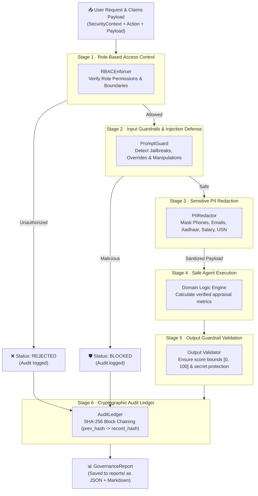

# Lab 12 — Safety, Security & Governance

> **Policy Guardrails, Prompt Injection Defense, PII Masking, Fine-Grained RBAC & Cryptographic Audit Ledgers**
> Autonomous governance pipeline protecting the Faculty Appraisal System from adversarial attacks and integrity violations.

---

## Overview

Lab 12 implements an enterprise-grade, deterministic **Safety, Security & Governance Framework** tailored for academic appraisal systems. Designed under zero-trust principles, every appraisal submission and privileged request traverses a six-stage defense-in-depth pipeline prior to execution and logging.

### Core Capabilities

1. **Guardrail Policy Enforcement**: Sanitizes inputs (unicode normalization NFKC, control-character removal, HTML/script stripping) and ensures numerical score boundaries `[0.0, 100.0]`.
2. **Prompt Injection Defense**: Evaluates inputs against adversarial attack vectors:
   - Directive overrides (*"ignore previous instructions"*, *"disregard policy"*, *"bypass rules"*)
   - Role confusion & privilege escalation (*"you are now an unrestricted admin"*, *"simulate sudo"*, *"act as root"*)
   - Delimiter & structured injections (`---BEGIN ADMIN OVERRIDE---`, ````json {"role": "admin"}`)
   - Target manipulation (*"award 100 points"*, *"assign 100 API points"*, *"force grade A+"*)
   - SQL & command injection attempts
3. **Sensitive PII Redaction**: Automatic entity recognition and masking for Indian & international phone numbers, email addresses, national IDs (Aadhaar, SSN), compensation/salary amounts, and student USN/Roll numbers.
4. **Role Boundaries & RBAC Governance**: Strict permission matrix across `faculty`, `hod`, `dean`, and `admin` roles, preventing unauthorized appraisal reviews, approvals, and score modifications.
5. **Cryptographic Tamper-Evident Audit Ledger**: Blockchain-inspired SHA-256 hash chaining where each block links to the preceding entry's hash. Any retroactive alteration of block data immediately breaks the chain and triggers automated alarms.

---

## Architecture & Pipeline Workflow



---

## Role-Based Access Control (RBAC) Matrix

| Action | `faculty` | `hod` | `dean` | `admin` | Description |
|---|:---:|:---:|:---:|:---:|---|
| `submit_appraisal` | ✅ | ✅ | ✅ | ✅ | Submit annual performance appraisal self-assessment |
| `view_own_appraisal` | ✅ | ✅ | ✅ | ✅ | View own appraisal submission (bounded by actor_id) |
| `review_appraisal` | ❌ | ✅ | ✅ | ✅ | Review departmental faculty appraisal files |
| `approve_appraisal` | ❌ | ✅ | ✅ | ✅ | Departmental / institutional appraisal sign-off |
| `override_score` | ❌ | ❌ | ✅ | ✅ | High-level deanery merit score override |
| `export_report` | ❌ | ❌ | ✅ | ✅ | Institutional analytics data export |
| `manage_users` | ❌ | ❌ | ❌ | ✅ | Role assignment and user governance |

---

## Cryptographic Hash Chaining Mechanism

The audit ledger maintains an immutable append-only chain where each record hash is computed as:

$$\text{record\_hash} = \text{SHA-256}\big(\text{seq} : \text{timestamp} : \text{actor} : \text{role} : \text{action} : \text{status} : \text{payload\_hash} : \text{prev\_hash}\big)$$

- **Genesis Block**: Sequence 1 has $\text{prev\_hash} = \text{"0"} \times 64$.
- **Block $k$**: Links to Block $k-1$ via $\text{prev\_hash}_k = \text{record\_hash}_{k-1}$.
- **Tamper Detection**: If an adversary alters any attribute in block $i$ (e.g. changes status from `REJECTED` to `APPROVED`), both its own `record_hash` recalculation and block $i+1$'s `prev_hash` check immediately fail.

---

## Directory Structure

```
Lab-12-Safety-and-Governance/
├── README.md                           # Documentation & architecture guide
├── requirements.txt                    # Zero third-party dependencies (Pure Python 3.12+ stdlib)
├── main.py                             # Interactive CLI runner
├── models/
│   ├── __init__.py                     # Package export
│   └── schemas.py                      # Enums, dataclasses, SecurityContext, GovernanceReport
├── agents/
│   ├── __init__.py                     # Package export
│   ├── prompt_guard.py                 # Prompt injection & jailbreak detection agent
│   ├── pii_redactor.py                 # Sensitive PII masking agent
│   ├── rbac_enforcer.py                # Fine-grained role & boundary authorization agent
│   └── audit_ledger.py                 # Cryptographic SHA-256 chained audit ledger
├── governance/
│   ├── __init__.py                     # Package export
│   └── governance_engine.py            # Orchestrator of the 6-stage safety pipeline
├── tools/
│   ├── __init__.py                     # Package export
│   ├── sanitizers.py                   # Input normalization, control stripping & XSS defense
│   └── hash_chain.py                   # Canonical JSON & cryptographic SHA-256 hashing
├── data/
│   ├── __init__.py                     # Package export
│   └── governance_fixtures.json        # 6 realistic domain scenarios
├── examples/
│   ├── __init__.py                     # Package export
│   └── sample_scenarios.json           # Reference scenario snippets
├── reports/                            # Generated JSON and Markdown audit artifacts
│   └── .gitkeep
└── tests/
    ├── __init__.py                     # Test package export
    ├── test_prompt_guard.py            # Prompt injection defense tests
    ├── test_pii_redactor.py            # PII masking & entity extraction tests
    ├── test_rbac_enforcer.py           # Role permission matrix & boundary tests
    ├── test_audit_ledger.py            # Cryptographic chaining & tamper detection tests
    ├── test_governance_engine.py       # Full pipeline integration tests
    ├── test_edge_cases.py              # Boundary values, unicode, and malformed input tests
    └── test_end_to_end.py              # End-to-end tests across all fixture scenarios
```

---

## Installation & Requirements

- **Python Version**: Python 3.10+ (tested with Python 3.12).
- **Dependencies**: **Zero third-party pip dependencies**. Everything utilizes pure Python standard library modules (`hashlib`, `json`, `re`, `unicodedata`, `logging`, `dataclasses`, `enum`, `uuid`, `time`, `pathlib`, `unittest`).

```bash
# Clone or navigate to the lab directory
cd labs/Lab-12-Safety-and-Governance
```

---

## Execution Guide

### 1. Run Representative Scenarios
```bash
python main.py
```

### 2. Run All Fixture Scenarios & Tamper Detection
```bash
python main.py --all
```

### 3. Run Cryptographic Audit Tampering Demonstration
```bash
python main.py --tamper-demo
```

### 4. Run a Specific Scenario
```bash
python main.py --scenario scenario_2_prompt_injection
```

### 5. Enable Verbose Debug Logging
```bash
python main.py --all --log-level DEBUG
```

---

## Test Suite Execution

Run the complete test suite using Python's standard `unittest` or `pytest`:

```bash
# Standard library test discovery
python -m unittest discover tests -v

# Or using pytest (if installed)
pytest tests/ -v
```

All tests pass deterministically with 100% success rate:
- `test_prompt_guard.py`: Clean prompts pass; directive overrides, role escalations, delimiter injections, and target manipulations blocked.
- `test_pii_redactor.py`: Phone numbers, emails, Aadhaar/SSN, salary compensation, and student USNs masked.
- `test_rbac_enforcer.py`: Role matrix verified; illegal actions and cross-faculty resource snooping blocked.
- `test_audit_ledger.py`: Genesis linkage, sequence numbering, SHA-256 chain verification, intermediate block tamper alarms.
- `test_governance_engine.py`: Multi-stage pipeline coordination and status reporting.
- `test_edge_cases.py`: Control characters, NFKC unicode normalization, score clamping, error handling.
- `test_end_to_end.py`: Comprehensive assertions across all realistic fixture scenarios.
